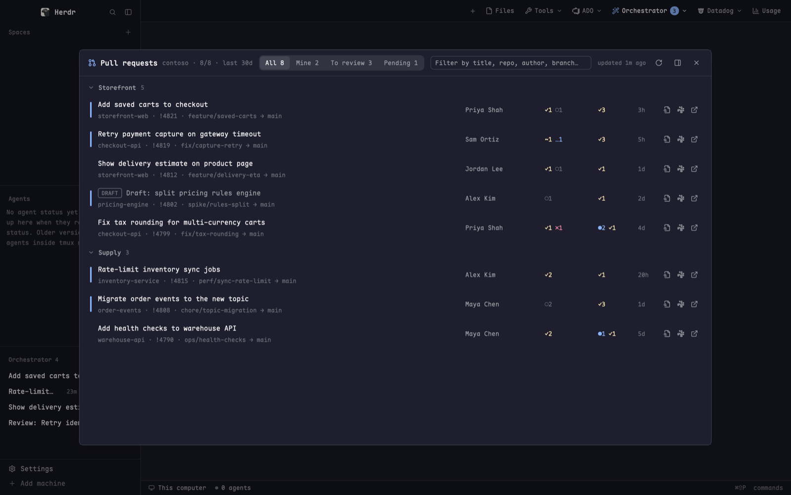
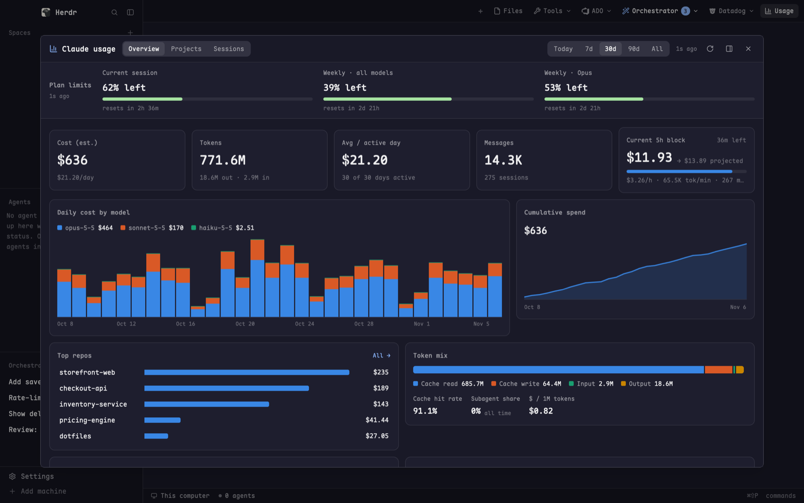
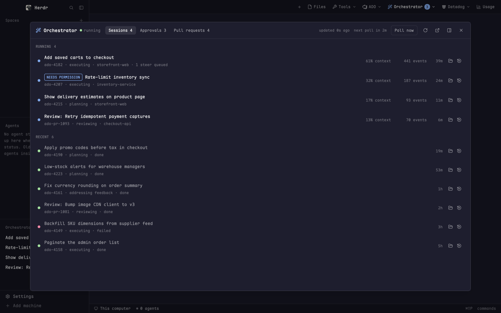
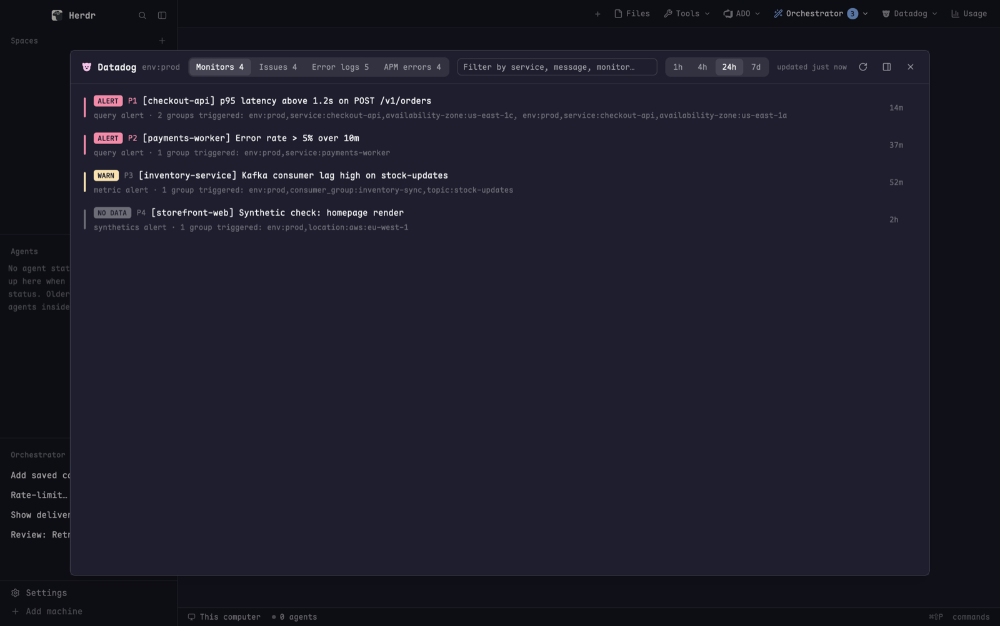
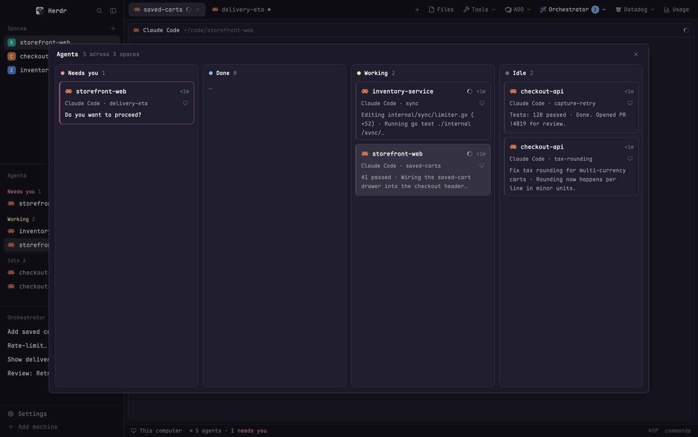
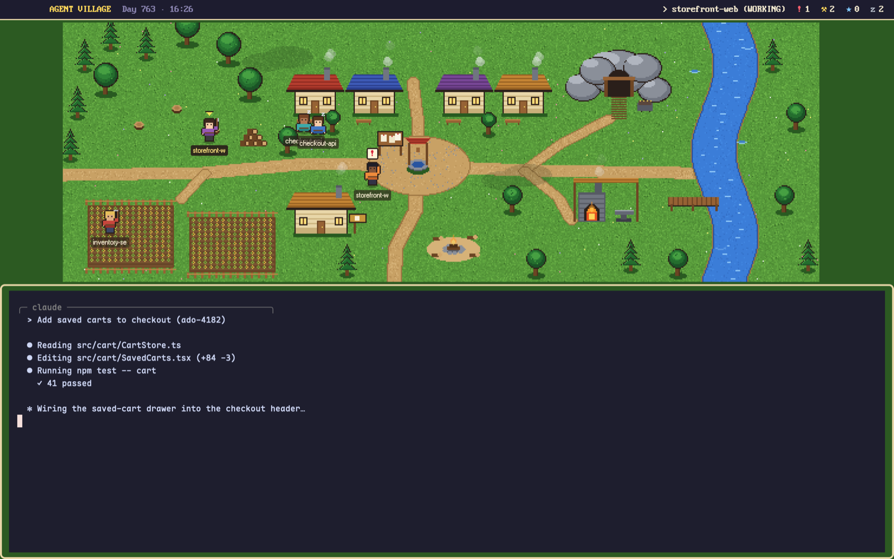

# herdr-addons

Mods, layouts and themes for [herdr](https://herdr.dev): Azure DevOps panels, a
Datadog triage panel, Claude Code usage, agent boards, an orchestrator inbox and
a tab bar that ties them together.

## What's here

Each folder is one addon, with its own `RECIPE.md` (a full description another
agent can rebuild it from), a `preview.png`, its mods, and its keys.

| Addon | Key | What it does |
|---|---|---|
| [**azure-devops**](azure-devops/RECIPE.md) | `⌘⇧R` `⌘⇧B` `⌘⇧I` `⌘⇧Y` | Pull requests, pipelines (with logs), work items (with an editable details view) and a team standup, for every project in your Azure DevOps org. An ADO dropdown in the tab bar opens them. |
| [**datadog**](datadog/RECIPE.md) | `⌘⇧E` | What needs attention in one Datadog env: triggered monitors, Error Tracking issues, clustered error logs, APM error spans. |
| [**cc-usage**](cc-usage/RECIPE.md) | `⌘⇧U` | Claude Code usage like ccusage: cost and tokens by day, model, repo, branch and session, the live 5-hour block, and your plan limits. |
| [**orchestrator**](orchestrator/RECIPE.md) | — | Inbox for a local agent-orchestrator daemon: sessions, plan and permission approvals, PR review queue, plus a sidebar list. Needs an orchestrator API at `orchestrator.url`. |
| [**agent-board**](agent-board/RECIPE.md) | `⌘⇧A` | Your agents as a kanban board with one column per status, plus a `board` layout. |
| [**agent-village**](agent-village/RECIPE.md) | — | Your agents as villagers on a pixel-art map, in the `village` layout. |
| [**pane-cycle**](pane-cycle/RECIPE.md) | `⌃⇥` `⌃⇧⇥` | Cycle panes across every space and tab, not just the current one. |
| [**my-main**](my-main/RECIPE.md) | — | Layout: herdr's main layout with a tab bar holding Usage, Tools, ADO, Orchestrator and Datadog buttons, and an Orchestrator list in the sidebar. Uses the addons above; the Tools entries come from [herdr-plugins](https://github.com/JacobAtchley/herdr-plugins). |

<table>
<tr><td></td><td></td></tr>
<tr><td></td><td></td></tr>
<tr><td></td><td></td></tr>
</table>

The screenshots use made-up data.

**Themes:** `themes/` has `catppuccin` (Mocha, dark) and `catppuccin-latte` (light).

## Requirements

- herdr-app on macOS.
- `python3` for `ado-standup`, `cc-usage` and `dd-attention`.
- Azure DevOps mods: the [Azure CLI](https://learn.microsoft.com/cli/azure/) with the
  `azure-devops` extension, and `az login`. All calls go through your own az login.
- Claude Code buttons: `claude` on your PATH.
- Datadog: an API key and an Application key (see Settings).

## Install

```sh
git clone https://github.com/JacobAtchley/herdr-addons ~/code/herdr-addons
cd ~/code/herdr-addons
./install.sh                         # every addon
./install.sh azure-devops cc-usage   # or only some (addon or mod names)
```

`install.sh` never overwrites anything you already have:

- Each mod is **copied** into `~/.config/herdr-app/mods/`. Don't symlink mods:
  herdr won't load a mod's icons through a symlink.
- Layouts and themes are copied over, unless you already have a file with that name.
- `addons.json` (your settings) is created from `addons.example.json` if you don't have one.
- Each addon's `keys.json` is added to yours. A key you already use is left alone
  and listed, so you can pick another one.

**To update** after a `git pull`, run `./install.sh --update`. It refreshes the
mods you already have; your `addons.json` and keys are left as they are.

**To send changes back:** if you edit mods inside herdr, run
`./install.sh --pull` to copy them into the repo, then review the diff and commit.

Set `HERDR_HOME` if your herdr-app folder is somewhere else. To use the layouts,
switch to them with `⌘⇧L`. To uninstall a mod, delete
`~/.config/herdr-app/mods/<name>`.

## Settings

All settings live in one file: **`~/.config/herdr-app/addons.json`**. It is
yours and is never committed here (`addons.example.json` is the template).
The mods read it each time they use a setting, so changes apply right away.
You don't need to reload anything. Every key is optional; if a key is missing,
the default below applies.

```json
{
  "claude": {
    "model": "opus",
    "models": { "review": "opus", "refine": "opus", "resume": "opus" },
    "folder": "~/code"
  },
  "ado": {
    "org": "my-org",
    "standup": {
      "project": "MyProject",
      "team": "My Team",
      "blockTags": ["Blocked", "Impediment", "external-dependency"]
    }
  },
  "datadog": { "env": "prod" },
  "orchestrator": {
    "url": "http://127.0.0.1:8490",
    "dashboard": "http://localhost:8490"
  }
}
```

| Setting | Used by | Default | Meaning |
|---|---|---|---|
| `claude.model` | ado-prs, ado-workitems, orch | `opus` | Model passed to `claude --model` by every Claude Code button. |
| `claude.models.review` / `.refine` / `.resume` | ado-prs / ado-workitems / orch | `claude.model` | Override the model for one button. |
| `claude.folder` | ado-prs, ado-workitems | your home folder | Folder the new Claude Code tab opens in, e.g. where your repos live. `~/` works. |
| `ado.org` | all ADO mods | `az devops configure` default | Azure DevOps organization name (the part after `dev.azure.com/`). |
| `ado.standup.project` | ado-standup | **required** | Project whose team the standup shows. |
| `ado.standup.team` | ado-standup | **required** | Team shown first. Switching teams in the panel is remembered. |
| `ado.standup.blockTags` | ado-standup | `["Blocked", "Impediment", "external-dependency"]` | Work item tags that count as an impediment. |
| `datadog.env` | dd-attention | `prod` | Datadog `env:` tag to watch. |
| `orchestrator.url` | orch, orch-sidebar, my-tabs | `http://127.0.0.1:8490` | The orchestrator daemon's API. |
| `orchestrator.dashboard` | orch, orch-menu | `orchestrator.url`, else `http://localhost:8490` | Its web dashboard, for "Open in browser". |

To change a setting, edit the file in any editor:

```sh
open -e ~/.config/herdr-app/addons.json     # or $EDITOR ~/.config/herdr-app/addons.json
```

Or change one value from the shell:

```sh
f=~/.config/herdr-app/addons.json
jq '.ado.org = "my-org" | .claude.folder = "~/work"' "$f" > "$f.tmp" && mv "$f.tmp" "$f"
```

If the file is missing or isn't valid JSON, every setting falls back to its
default. For the ADO org, you can instead set the az default once and leave
`ado.org` out:

```sh
az devops configure -d organization=https://dev.azure.com/my-org
```

### Secrets: environment variables only

API keys never go in `addons.json` or this repo. The Datadog panel reads them
from your shell environment. Add them to `~/.zshenv`, which the panel loads
through a login shell:

```sh
export DD_API_KEY=…            # Organization Settings → API Keys
export DD_APP_KEY=…            # Organization Settings → Application Keys
export DD_SITE=datadoghq.com   # optional: datadoghq.eu, us3.datadoghq.com, …
```

The Azure DevOps mods use your `az login` and keep no tokens.
`cc-usage`'s plan-limits row reads Claude Code's own login from the macOS
Keychain (`Claude Code-credentials`) and only sends it to Anthropic's usage endpoint.

### Other things you can change

- **Keys:** `~/.config/herdr-app/keys.json` (`"cmd-shift-r": "mod.open:ado-prs"`).
  The dropdown menus show whatever key you bind.
- **Theme:** `"theme": { "light": "catppuccin-latte", "dark": "catppuccin" }` in
  herdr's `settings.json` follows the system's light or dark mode.
- **Constants** at the top of each `main.js` (refresh intervals, how far back
  lists go, row caps) are meant to be edited. `./install.sh --pull` copies
  your edits back into the repo.

## Notes

- `my-tabs` and the `my-main` layout are copies of herdr's shipped tab bar and
  main layout. They don't get herdr's updates to those files.
- The ADO mods work across every project in the org, so a large org can take a few seconds to load the first time.
- Attachment images in work item details are downloaded with your az login to
  `~/.config/herdr-app/cache/ado-workitems/`.

## License

MIT
