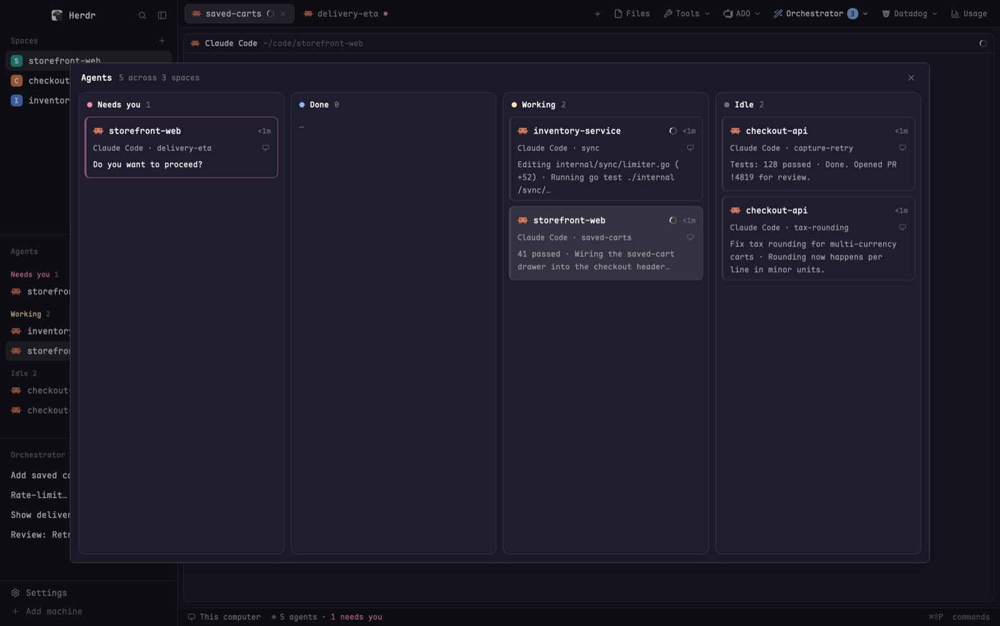

# Agent Board

Every agent you run, on one kanban board: a column for each status (Needs you,
Done, Working, Idle) and a card per agent with its space, program, tab, how
long it has been in that status, and the last thing it said. Blocked agents
show the question they're waiting on. Click a card to jump to that agent. It
opens as a dialog with `cmd-shift-a`, or as the `board` layout: the board on
top, the focused agent's terminal underneath.

## What you see

- **Header**, 44px high, 16px side padding (84px on the left inside the
  layout, to clear the traffic lights): "Agents" in 13px semibold
  `foreground`, then "N across M spaces" in 12px `dim`. In the dialog, a 14px
  close `x` (`mods/workspace-chrome/x.svg`) sits at the right in `dim`,
  `hover` background on hover.
- **Board**, filling the rest, 12px padding (none on top), 10px gaps,
  background `canvas` (falls back to `chrome`). Four columns side by side,
  equal width, in this order:
  1. **Needs you** (`blocked`)
  2. **Done** (`done`)
  3. **Working** (`working`)
  4. **Idle** (`idle`)
- **Each column**: `surface`, 1px `border`, 10px radius. A 36px header with an
  8px dot in the status's theme color (`theme().blocked`, `.done`,
  `.working`, `.idle`; `dim` if missing), the label in 12px semibold
  `foreground` and the card count in 12px `dim`. Below, cards with 8px side
  padding and 8px gaps, scrolling on their own. An empty column shows "—" in
  12px `dim`.
- **Each card**: 10px padding, 6px gaps, 8px radius, 1px `border` with a 3px
  left edge; a blocked card's border is its status color at 50% alpha (`80`
  hex suffix). Background `background`, or `selected` for the agent currently
  shown; `hover` on hover. Three rows:
  1. The program's 16px icon (tinted `foreground` if the icon is tintable),
     the space name in medium `foreground` (truncated; falls back to the
     program name, then the address), a 12px spinner in the status color for
     working agents, and the time in this status ("<1m", "12m", "3h", "2d")
     in 11px `dim`.
  2. In 11.5px `muted`: "program · tab N" (a tab named only with digits reads
     "tab 3", otherwise its name), "@machine" in `dim` for an agent on another
     machine, a "+2 sub" pill (`raised`, `dim`, 4px radius) when it has live
     sub-agents, and a 12px monitor icon (Peek) at the far right.
  3. What it last said, in 12px, at most 54px tall (about three lines), cut at
     180 characters with "…". `foreground` for blocked agents, `muted`
     otherwise. Hidden until the first read.
- **Narrow** (board under 640px wide): the columns stack top to bottom at full
  width and the whole board scrolls instead of each column.
- **No agents**: "No agents yet. They show up here once they report a
  status." in 12px `dim` under the header.
- **The `board` layout**: no titlebar, traffic lights at 16,16, background
  `canvas`, a 1px `border` divider. Top block (weight 2, min 160px) is the
  board and drags the window; bottom block (weight 3, min 120px, background
  `background`, terminal padding 14 x 12) shows the focused agent.

## How it behaves

- **Statuses**: `blocked` (Needs you), `done` (finished while you weren't
  looking), `working` (spinner), `idle`. A card moves columns when its agent's
  status changes.
- **Order**: newest status change first within a column, then newest agent.
  The board passes that order to `setAgentOrder`, so `agent.next` /
  `agent.prev` walk the board top-left to bottom-right.
- **Time in status**: the board notes each agent's status and when it changed,
  saved in `localStorage` (`changed`), so the times survive a restart. Agents
  seen for the first time count from when the board first saw them.
- **What it said**: every 4 s the board reads each agent's last 40 screen
  lines (`hc read <address> --lines 40`), one agent after another, never two
  passes at once. It drops the input box (the first long `─`/`━`/`═` rule in
  the last 14 lines), box-drawing lines and hint/footer lines ("Tip:",
  "shift+tab", "esc to interrupt", "auto mode", "bypass permissions", ...),
  strips leading symbols, and keeps the last two lines joined with " · ". For
  a blocked agent it reads the whole screen and prefers the last line ending
  in "?".
- **Clock**: redraws every 30 s so the times move.
- **Click a card**: closes the dialog if it is one, then in the layout runs
  `agent.focus {terminal}` (the bottom block shows that agent); anywhere else
  runs `pane.focus {pane}`.
- **Click Peek** (monitor icon, tooltip "Peek"): `terminal.peek {terminal}`,
  without opening the card.
- **Highlighted card**: in the layout, the agent in the bottom block
  (`focused().agent`); elsewhere, the agent in the focused pane.
- **Keys**: `cmd-shift-a` runs `mod.open:agent-board` (the dialog).

## Built from

- **`mods/agent-board/`**
  - `mod.json`: `{ "place": "none", "title": "Agent board", "overlay": {
    "kind": "dialog", "width": 0.86, "height": 0.8 } }`. Not docked; opened
    as a dialog, a pane/tab, or by a layout.
  - `main.js`: one `View`. Props it reads: `overlay` (set when opened as a
    dialog; shows the close button and is closed on card click) and `layout`
    (`true` inside the `board` layout).
- **herdr**: `agents()`, `terminals()` (counts live sub-agents by `parent`),
  `spaces()`, `theme()`, `focused()`, `props()`, `hc(["read", ...])`,
  `run("agent.focus" | "pane.focus" | "terminal.peek")`, `closeOverlay`,
  `setAgentOrder`, `localStorage`, `cx.timer.every`, `cx.spawn`,
  `on_size_change`.
- **Art**: no art of its own. Uses icons from the shipped `workspace-chrome`
  mod: `spinner.svg` (spun with `.spin(900)`), `monitor.svg`, `x.svg`; agent
  icons come from `a.program.icon` (`svg` when `a.program.tint`, else
  `image`).
- **`layouts/board.json`**: a `column` root (`titlebar: "none"`) with block
  `board` (`{ "mod": "agent-board", "props": { "layout": true } }`,
  `window_drag: true`) over block `agent` (`{ "agent": "focused" }`).
  `layouts/board.svg` is its preview in the layout switcher.
- **`keys.json`**: `{ "global": { "cmd-shift-a": "mod.open:agent-board" } }`.
- No network, no settings from `addons.json`, no programs besides `hc`.

## Watch out

- The board block drags the window, so a card must stop `mouse_down`
  propagation or clicking it drags instead. Peek stops both mouse-down and
  click so it doesn't also open the card.
- The layout has no tabs or panes for agents, only the agent block: use
  `agent.focus` there, not `pane.focus`.
- Spin the spinner natively (`.spin(900)`); don't redraw on a fast timer for
  it. Screen reads are every 4 s and the clock every 30 s on purpose.
- `hc read` is slow across many agents; guard with a flag so passes don't
  overlap, and swallow failures (an agent can vanish mid-pass).
- Gist parsing is tuned to Claude Code-style screens (a rule above the input
  box, known footer hints). Other agents may show chrome or nothing.
- The 640px stack point uses the width from `on_size_change`; until the first
  size event the board lays out as columns.
- `selected`, `canvas`, `surface`, `raised` and the status colors must exist
  in the theme; only `canvas` (to `chrome`) and the status colors (to `dim`)
  have fallbacks.
- `workspace-chrome` must be installed (it ships with herdr) for the icons.

## Done when

- `herdr-app check` passes for `agent-board`.
- `cmd-shift-a` opens the board as a dialog with four columns in the order
  Needs you, Done, Working, Idle, each with a count; the `x` closes it.
- A working agent's card sits in Working with a spinning ring; when it asks a
  question it moves to Needs you with a tinted border and the question as its
  text.
- Clicking a card closes the dialog and focuses that agent's pane; Peek opens
  a peek without closing the dialog.
- `layout.switch board` shows the board above the agent; clicking a card
  swaps the agent below and highlights that card with `selected`.
- Narrowing the board below 640px stacks the columns.
- Time-in-status values survive restarting herdr-app.
