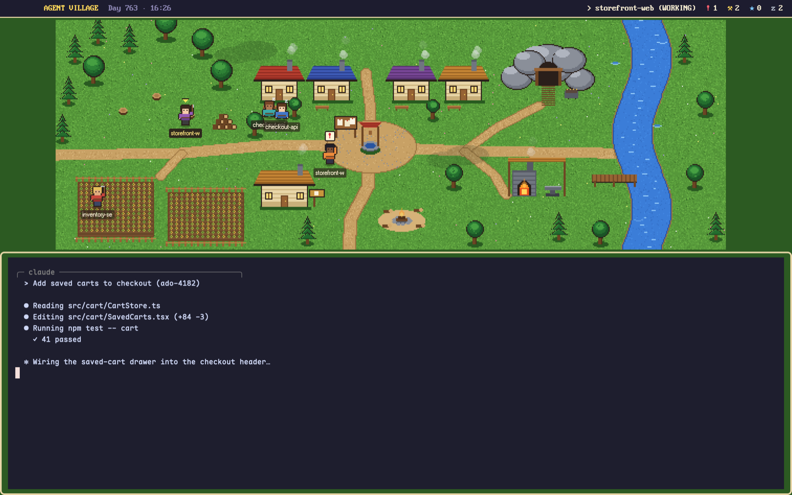

# Agent Village

Your agents live in a small pixel-art village. Each agent is a villager. A
working agent goes to a job (chopping wood, farming, mining, smithing,
fishing) and swings its tool. An agent that needs you waits at the notice
board with a "!" over its head. Finished agents cheer by the campfire, and
idle ones doze on benches outside their cottages. A bar along the top counts
each status. Click a villager and its terminal shows in the dialog box below
the map.

## What you see

The `village` layout is one column on a grass-green window (`#2c5a22`) with
no titlebar. The traffic lights sit at 16, 10.

- **The village**, 482px high (it can shrink to 200px). It holds:
  - **The status bar**, 34px high across the full width, `#1b1530` at 90%
    opacity, with a 2px `#e8d6a8` line under it. Text is "PxPlus IBM VGA
    8x16" at 16px, and the bar starts 84px in so it clears the traffic lights.
    From left to right:
    - "AGENT VILLAGE" in `#ffd65a`
    - "Day N · HH:MM" in `#8a84b0`. N is days since 1970 mod 1000, and the
      time is local.
    - a spacer
    - for the focused agent: "> {space name} (STATUS WORD)" in `#f4ead0`
    - four counters, each a glyph in its status color followed by the count in `#f4ead0`:
      `!` blocked (`#ff5f6d`), `⚒` working (`#ffd65a`), `★` done
      (`#7fc8ff`), `z` idle (`#b8c0cc`).
  - **The map**: one 640×220 art-pixel picture drawn at 2× (1280×440
    logical px). It is centered horizontally and centered vertically in the
    space under the bar. The bar overlaps the map's top edge when the block
    is short. Anything outside the block is clipped. The picture has a
    lumber camp at the top left, a farm field at the bottom left, a mine at
    the top right, a forge at the bottom right, a dock on water at the far
    right, four cottages with benches across the top middle, a notice board
    in the center and a campfire at the bottom center.
  - **Ambience** on the map: two puffs of smoke rising from each of six
    chimneys, flickering flames at the forge and the campfire, ripples
    fading in and out on the water, and two clouds drifting slowly to the right.
  - **Villagers**: 16×22 art-px sprites (32×44 logical). Each agent has one
    of 8 outfits. Under each villager's feet is a name plate: its space name
    (or program name, or address), cut to 12 characters, in "Pixelated MS
    Sans Serif" at 11px, `#f4ead0` on `#2a1f1a` at 67% opacity with
    rounded corners. The focused villager's plate is `#ffe680` on a nearly
    solid `#2a1f1a`, and a small bouncing arrow points down at its head.
  - **Apprentices**: up to 3 smaller 10×14 sprites at a villager's side, one
    for each of the agent's live sub-agent terminals.
  - **Empty village**: with no agents, a 340px box in the middle of the map
    (`#1b1530`, 3px `#e8d6a8` border, 6px radius) reads "The village is
    quiet. Start an agent and a villager will move in."
- **The dialog**: the rest of the height, at least 120px. It shows the focused
  agent's terminal in a box with a 3px `#e8d6a8` border and 8px radius, on
  `#1b1530`, with 8/12px padding, all set on the green background.

## How it behaves

- **Statuses:**
  - **working**: the villager stands at its job with that job's tool pose
    and bobs 1 art px every 420ms. A small effect (wood chip, dirt, rock,
    spark or ripple) rises and fades in and out over the tool. The job comes
    from the agent's address, so an agent always gets the same job.
  - **blocked**: the villager stands at the notice board in the alert pose and
    hops 3px every 700ms. Above it, a cream (`#fff6d8`) 20px rounded badge
    with a dark border holds a red (`#d8263a`) "!" that bobs too.
  - **done**: the villager stands by the campfire in the cheer pose and hops
    4px every 560ms, with a sparkle that pulses over its head.
  - **idle**: the villager sits on a bench while "z", "zZ", "zZz" cycle every
    700ms beside its head.
- **Placement:** agents are placed in order of their `seq`. Each status and
  job has a fixed list of spots, and an agent starts at a spot picked from its
  address hash, then takes the next free one. When every spot is taken, extra
  villagers crowd in 9 art px to the right of an existing spot and 4 px lower.
  Villagers lower on the map are drawn in front.
- **Click** a villager: inside the layout it runs `agent.focus` with
  `{terminal: address}`, which puts that agent in the dialog. Used as a mod
  without the layout, it runs `pane.focus` with `{pane}`.
- **Right-click** a villager: `terminal.peek` on it.
- **Click** an apprentice: `terminal.peek` on that sub-agent.
- **Hover** a villager: a tooltip with "{space} · {tab}" (a numeric tab name
  shows as "tab N") and "{program} — {status}". Hover an apprentice to see its
  name, template, program or address.
- **Agent order:** each render sets herdr's agent navigation order to match
  the map: blocked first, then done, working and idle, and left to right
  within each.
- **Updates:** the map redraws whenever herdr's agent list changes. The clock
  updates every 30 seconds. Nothing is saved.
- **Dragging:** the village block drags the window, except on villagers and
  apprentices.

## Built from

- **`layouts/village.json`**: a `column` root with `titlebar: "none"`,
  `traffic_lights: [16, 10]`, `background: "#2c5a22"`,
  `terminal_padding: [14, 10]`, `preview: "layouts/village.png"`. Children:
  - `village`: a block with `size: {px: 482}`, `min: 200` and `window_drag: true`,
    holding `{mod: "agent-village", props: {layout: true}}`.
  - `dialog`: a block with `size: {weight: 1}`, `min: 120`, `padding: [8, 12]`,
    `background: "#2c5a22"`, `colors: {background: "#1b1530"}`,
    `content: {agent: "focused"}`, `border: {width: 3, color: "#e8d6a8"}`,
    `radius: 8`.
- **`mods/agent-village/`**:
  - `mod.json`: `{"place": "none", "title": "Agent village"}`.
  - `main.js`: a `View` class from `gpui-kit` (`div`, `image`).
  - **Props:** `layout` (boolean). When it is true, clicks use `agent.focus` and
    the highlighted villager is `focused().agent`. Without it, clicks use
    `pane.focus` and the highlighted villager is the agent with `focused: true`.
  - **herdr functions:** `agents()` (address, seq, status, space_name,
    tab_name, program, app, pane, focused), `terminals()` (for sub-agents:
    `parent === address && state === "live"`), `focused()`, `props()`,
    `run()`, `setAgentOrder()`.
  - **Commands:** `agent.focus`, `pane.focus`, `terminal.peek`.
  - No network, no programs, no files outside the mod, no `addons.json`
    settings.
  - `stations.js`: exports `STATIONS`, generated data that matches the map art:
    - `map: {w: 640, h: 220, sprite: [16, 22], outfits: 8}`
    - `work`: `axe`, `hoe`, `pick`, `hammer` and `rod`, each with `fx` (the
      effect sprite) and `slots` (foot positions in art px). `rod` also has
      `cast: [16, 8]`, the effect offset at the line's end.
    - `blocked`, `done` and `idle`: `slots`, with 6, 6 and 8 spots.
    - `smoke`: 6 chimney points. `fire`: 2 points.
  - **Art**, in `art/` at 4× art pixels so it stays sharp at 2× on Retina:
    - `map.png` (2560×880)
    - `v/{0-7}-{stand,sit,alert,cheer,axe,hoe,pick,hammer,rod,kid}.png`:
      80 sprites, 64×88 each (kid: 40×56)
    - `arrow` (7×5 art px), `sparkle` (7×7), `smoke` (8×8), `flame` (7×9),
      `ripple` (9×3), `cloud` (60×22), and the work effects `chip`, `rock`,
      `dirt` and `spark`
    - All of it, plus `stations.js`, came from a separate Pillow script that is
      not in this repo. A rebuild needs new art whose spot coordinates
      match the map.
- **Motion** uses gpui-kit `.loop(prop, {from, to, period, easing})` on `top`,
  `left` and `opacity`, plus `.frames([...], ms)` for the z's. A
  `cx.timer.every(30000)` keeps the clock current, and `on_size_change` keeps
  the map centered.

## Watch out

- Every position is in art px times `S = 2`. Spots in `stations.js` are
  **feet** positions: the sprite goes at `x - 8`, `y - 21`. Map art and
  station coordinates must come from the same source, or villagers stand
  in the water.
- The block has `window_drag: true`, so each villager and apprentice must
  call `cx.stop_propagation()` on left and right mouse-down. If it doesn't,
  a click drags the window instead of focusing the agent.
- Element ids (`v-{address}`, `kid-{address}`) must be stable for tooltips
  and clicks to work across re-renders.
- The 84px left padding on the status bar is there for the traffic lights,
  since the titlebar is hidden.
- Colors are fixed hex values, not theme colors, so the village looks the
  same in light and dark themes.
- The two pixel fonts ("Pixelated MS Sans Serif", "PxPlus IBM VGA 8x16")
  must be installed. Without them, text falls back to a different font.
- At most 3 apprentices are shown per villager. The job comes from
  `hash % 5`, so two agents can land on the same job. A full job crowds
  more villagers beside its spots.
- `setAgentOrder` runs on every render. Leave it out and the navigation keys
  will no longer follow the map.
- The "Day" counter is not a real date. It is `floor(now / 1 day) % 1000`.

## Done when

- `herdr-app check` passes for `agent-village`, and `layout.switch village`
  shows the map above a bordered terminal box.
- With no agents, the "The village is quiet" box shows in the middle of the map.
- A working agent stands at one of the five jobs, bobbing with a rising
  effect, and keeps the same job after a restart.
- An agent waiting for input moves to the notice board with the bouncing "!",
  and the red `!` count in the bar goes up.
- Clicking a villager shows its terminal in the dialog, adds the arrow over
  its head, and shows its name in the bar. Right-clicking it opens a peek.
- Dragging the green grass moves the window, and clicking a villager does not.
- Resizing the window keeps the map centered under the bar.
