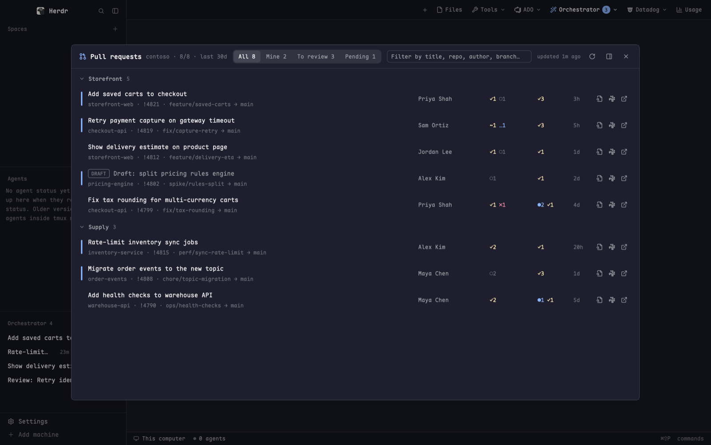

# Azure DevOps

Your Azure DevOps day without a browser. An "ADO" button in the tab bar drops
down four tools, each also on a key: every active pull request in the
organization with its votes and open comments; recent pipeline runs across all
projects with a live, colored log viewer; your work items, with a details view
you can edit and save; and a one-screen team standup (completed work, PRs
needing review, impediments, failed builds, production deploys). Everything
signs in through the `az` CLI login, and nothing needs a token.

## What you see

**The ADO menu** (`ado-menu`) is a 300 x 218px popup. It opens from an "ADO"
button in the tab bar: 26px high, `chrome` background, `muted` 12px text, the
Azure DevOps logo at 14px and a 11px chevron. The popup lists four rows, each
52px tall with 5px padding around the list: a 15px icon in `muted`, a title in
12.5px `foreground`, a one-line description in 11px `dim`, and the row's key on
the right in 11px `dim` (from keys.json, drawn as glyphs like `⌘⇧R`). Rows go
`hover` on hover.

| Row | Description | Key |
|---|---|---|
| Pull requests | Active PRs across all projects | `cmd-shift-r` |
| Pipelines | Recent runs and their logs | `cmd-shift-b` |
| Work items | Assigned to me, last 30 days | `cmd-shift-i` |
| Standup | Team's completed work, reviews, blockers, deploys | `cmd-shift-y` |

The four tools share one look. Each one is a dialog on `surface`. A header row
has 16px side padding, 10px vertical padding and a 1px `border` below. From left
to right it holds:

- a 16px icon in `accent`
- the title in 14px semibold
- `org · shown/total` in 12px `dim`
- filter pills in a `raised` group (2px padding, 8px radius). The active pill is
  `selected` with `foreground` text, and the rest are `muted`, in 12px.
- a search box, 26px high, on `background` with a 1px `input` border
- a 130px `#` PR id box ("PR id ↵"). Enter looks up that one PR, from the
  loaded list or else by id at the org level (any project, status or age), and
  pins it in a `raised` card above the list with a COMPLETED or ABANDONED badge
  when closed, or "!id doesn't exist, or you can't read it". The card's × or an
  empty box clears it. The pills and search don't apply to it.
- a status line in 11px `dim`: "loading…", "updated 3m ago", or "fetch failed"
  in `blocked`
- a refresh icon that spins while loading
- when the tool is open as a dialog, a "dock beside this pane" icon and a close
  icon

Icons are 14px in `muted`, with 5px padding, and go `hover` on hover. List rows
have 12px side padding, 7px vertical padding and a 6px radius. They go `hover`
on hover, and their sub-lines are in 11.5px `dim`.

**Pull requests** (`ado-prs`) is a dialog of 80% x 80%. The filters are All,
Mine, To review and Pending, each with its count. Rows are grouped by project,
the biggest group first. Each group header shows a chevron (click it to fold),
the project in 12px semibold `muted` and the count. Each row, left to right:

- a 3 x 30px lead bar: `accent` if it waits on your review, `done` if you wrote
  it, transparent otherwise
- the title in 13px, `muted` when the PR is a draft. Before the title can come
  outlined 10.5px badges: "DRAFT" in `dim`, and "CONFLICT" in `blocked` when
  the merge status is `conflicts`.
- the sub-line `repo · !id · source → target`
- the author in a 140px column, 12px `muted`
- votes in a 90px column: `✓n` and `~n` in `working`, `…n` (waiting for author)
  in `done`, `✗n` in `blocked`, `○n` (no vote) in `dim`. The tooltip names every
  reviewer, marked "(required)" where it applies.
- comments in a 64px column: `●n` unresolved in `done`, `✓n` resolved in
  `working`, "…" while loading, "—" for none
- the age in a 32px column (`5m`, `3h`, `2d`)
- three action icons: Review with Claude Code, Copy Slack message, Open in
  browser

**Pipelines** (`ado-pipelines`) is a dialog of 90% x 86%. The filters are All,
Mine, Failed and Running. It shows one flat list, newest first. Each row has:

- a status glyph: `✓` `ansi2`, `✗` `ansi1`, `!` `ansi3` (partially succeeded),
  `●` `ansi4` (running; it pulses opacity 0.35 to 1 every 1.2s), `◌` `dim`
  (queued), `⊘` `dim` (canceled or abandoned), `–` skipped
- the pipeline name in 13px, then the build number in `dim`
- the sub-line `project · repo · branch · reason`. A PR ref shows as `PR !id`.
- the person in a 140px column
- the status word in a 110px column, in the glyph's color
- the duration in a 70px column (`45s`, `3m 07s`, `1h 02m`)
- the age in a 36px column ("now" if under a minute)

Clicking a run opens its detail, which replaces the list. The header gets a
back arrow, the glyph, the name, the number and the status, with the sub-line
`project · repo · branch · person · duration` ("so far" while running). It also
gets a "live" status, Reload, and Open in browser. Below the header are two
panes:

- **Timeline**, 340px wide with a 1px `border` on its right. Stage, then job,
  then task, indented 14px per level. Stages and jobs are semibold, `muted` and
  fold with a chevron. Tasks are 12px `foreground`. A step shows an error and
  warning count (`2✗ 1!`, 10.5px, `blocked` or `done`) and its duration. The
  selected step is `selected`, and a step's tooltip lists up to 6 issues.
- **Log**, on `background`. A bar shows the step name, "N lines", an
  "Errors only N" toggle pill and a "Copy" pill. Lines use the terminal font
  (`settings().font_family`) at 12px, with a 44px right-aligned line number.
  Error lines are tinted `ansi1` at alpha `2e` with a solid "ERROR" chip, and
  warnings get `ansi3` and "WARN". ANSI colors from tools are kept. Uncolored
  text is colored by what it is:
  - `##[section]`: `accent`, bold
  - `##[command]`: `ansi4`, shown as `$ …`
  - `##[group]`: bold
  - debug, separators and "Finishing:": `dim`
  - words like error or failed: `ansi1`
  - words like warning: `ansi3`
  - words like succeeded or passed: `ansi2`
  - shell prompts: `ansi6`
  - `Key : value` headers: the key in `dim`
  - URLs: `accent`, underlined

**Work items** (`ado-workitems`) is a dialog of 80% x 80%. The header holds:

- Mine / Others pills, with counts
- "Last 30d by" Created / Updated pills
- a "Closed N" toggle
- the search box
- a 150px `#` id box ("Work item id ↵"). Its border turns `accent` while a
  lookup is shown.

Mine is grouped by project. Others is grouped by assignee, with "Unassigned"
first. Each row has:

- a 3 x 30px lead bar in the type color: Bug `ansi1`, Feature or Epic `ansi5`,
  User Story `ansi4`, Technical Story `ansi6`, Task `ansi3`, Enhancement
  `ansi2`, anything else `dim`
- `#id` in `dim`, then the title in 13px (`muted` when done)
- the sub-line: type (in its color), assignee (Others only), the last segment
  of the iteration, and up to 4 tags as `raised` chips
- the priority (`P1` in `ansi1`, others `dim`)
- an outlined state pill in a 120px column. Done states are `ansi2`; fail and
  block are `ansi1`; QA, test, review and resolved are `ansi3`; hold is `dim`;
  New, Proposed and To Do are `muted`; the rest `ansi4`.
- the age
- three icons: Details, Refine with Claude Code, Open in browser

A lookup result pins above the list as a `raised` card titled "Lookup #id",
with a clear button.

**Work item details** replaces the list. The header has back, `#id`, the type in
its color, the title in 14px semibold, then Edit, Reload, Refine and Open (or
Cancel and Save while editing). The body has 20px side padding, 16px vertical
padding and 18px gaps. It shows:

- a wrap of facts with 10.5px `dim` labels: State (a pill), Assigned to,
  Priority, the points field (Story Points, Effort or Size, whichever the type
  has), Iteration, Area, Parent (an `accent` link that opens the parent),
  Created and Updated (`person · 2d ago`)
- tags as chips
- "Pull requests", only when the item has PR links (`ArtifactLink` relations
  whose url is `vstfs:///Git/PullRequestId/<project>%2F<repo>%2F<id>`; load the
  item with `$expand=relations`, then each PR by id at the org level). Each PR
  is a bordered row: a status badge (ACTIVE `accent`, COMPLETED `working`,
  ABANDONED or DRAFT `dim`), `!id title`, `repo · source → target · author`
  in `dim`, then `✓n` approvals and `…n` waiting votes. A click opens it in
  the browser. Hidden while editing.
- the rich-text fields: Description, Repro Steps, Acceptance Criteria and System
  Info first, then any other HTML field the type has. Each one is a `raised`
  box (12px padding, 8px radius) headed by its name and a "Markdown" or "HTML"
  badge, rendered with images inline.
- "Discussion": up to 100 comments, newest first, each in a bordered box with
  its author and age

**Standup** (`ado-standup`) is a dialog of 94% x 90%. Header row 1:

- the icon and "Standup", with `project · area`
- team pills (every team in the project)
- window pills: "Since yesterday", or "Since Fri" on a Monday, then "3 days",
  "7 days" and "14 days"
- the status line, refresh, dock and close

Row 2 is "Person", then an "Everyone" pill and one pill per team member.

The body has 16px padding and 12px gaps. At the top are seven stat tiles, each
at least 120px wide, on `background` with a 10px radius. Each tile has an 11px
`muted` label, a 26px semibold number and a 10.5px `dim` sub-label. The tiles
are Completed, To QA, Needs review, New work, Impediments (the number turns
`#ec835a` when above 0), Failed builds and To production.

Below the tiles are three rows of two cards. Cards sit on `background` with a
1px `border` and a 10px radius, and each title is 13px semibold with a count
chip.

- **Completed**:
  - a legend
  - a horizontal bar per person: Closed `#3987e5`, Moved to QA `#199e70`, on a
    120px label column, with 12px bars
  - a "Last 14 days" column chart, 96px tall, with days outside the window at
    40% opacity
  - the first 8 items, then "Show all N"
- **PRs needing review**: oldest first. Each row has an age bar under it in
  `#9085e9`, or `#fab219` once the PR is 5 or more days old.
- **Impediments**: grouped as Failing main builds, Stuck PRs, Blocking tags and
  Stale in progress (3d+). It shows 6 per group, and each row's lead bar shows
  severity: `#d03b3b` critical, `#ec835a` serious, `#fab219` warning.
- **New work**: bars by type in `#d95926`, then items.
- **Build failures**: bars per pipeline (top 10, 170px labels): failed
  `#d03b3b`, partial `#ec835a`. A "PR builds N" pill in the card header includes
  PR validation runs. The card lists 6 runs, then "Show all".
- **Promoted to production**: a 22px timeline lane across the window with day
  ticks and a 12px dot per deploy (`#0ca30c` succeeded, `#d03b3b` failed),
  then rows. Click a row to expand the work items it shipped.

If some sections fail, a red-tinted banner says "Some data didn't load: …".

## How it behaves

- **Opening.** The ADO button opens the menu popup. Picking a row closes the
  popup and runs `mod.open` for that tool. The keys open the tools directly.
  Every tool's "Open beside this pane" closes the dialog and runs `pane.split`
  to the right with the same mod. Work items passes `{detail: id}` so the open
  item stays open.
- **Rows.** Clicking a PR row opens its review view (below); the external-link
  icon opens it in the browser. A pipeline row opens its
  detail. A work item row opens its details. A standup row opens its URL. Action
  icons stop the click from reaching the row.
- **Filters and search.** Filtering is instant and local. Search matches title,
  repo, project, author, branch and id for PRs. For pipelines it matches
  pipeline, number, branch, repo, person, project and id. For work items it
  matches title, id, type, state, assignee, iteration and tags.
- **PR filters.** "Mine" means you wrote it. "To review" means you are a
  direct reviewer with no vote yet or "waiting for author", on someone else's
  PR. "Pending" means not a draft and nobody has voted.
- **PR review view.** Opens in the same dialog or pane, with a back arrow to the
  list. It can also be opened with props `{review: {project, repoId, id}}`, or
  by typing an id into the PR id box in the list header.
  - Header: `#id`, title, repo, `source → target`, author and age, a
    Publish / Mark as draft toggle, and the vote buttons: Wait for author,
    Reject, Approve (Approve / Approve with suggestions) and Reset. Votes are
    10, 5, 0, -5 and -10. The current vote is highlighted. A refused write
    (a non-author toggling draft, a vote on a closed PR) shows the error and
    keeps the server's state.
  - Status strip: reviewer chips (vote, "required") and gate chips. A build
    gate opens that run in `ado-pipelines`, and a linked work item opens in
    `ado-workitems`, both in a split pane beside the review. Other gates show
    their reason in a tooltip. The PR refreshes every 30 s while a build or check gate is running (policy gates waiting on votes don't trigger it).
  - Left list: Overview, then the changed files with a change letter and a
    thread count. The Overview has the description, linked work items, general
    threads with a new-comment box, and a summary of file threads.
  - File page: the diff with threads inline, Reply, Resolve and Reactivate.
    Resolved threads start collapsed. Click a line number to comment, and
    shift-click a second one to comment on a range. Syntax colors come from
    `bat` (`Catppuccin Mocha` in dark, `Catppuccin Latte` in light) and sit
    under the add/delete tints. Without `bat` the toolbar says "Install bat
    for syntax highlighting (brew install bat)" and diffs are plain text.
  - Toggles: Unified / Split, and All changes / Since last look (disabled when
    there is no earlier look). Unified / Split is remembered per mod copy.
    "Since last look" compares against the version you saw on your previous
    visit, kept per mod copy, so a dialog and a split pane track it separately.
    The view always opens on All changes.
  - Unsent comments are saved to `~/.config/herdr-app/cache/ado-prs/drafts.json`
    and deleted after 7 days. They survive going back, closing and restarts.
    A draft whose line is gone shows as an unplaced draft.
- **Review with Claude Code** opens a new tab named `Review !id` running
  `claude --model <model>` in `claude.folder`. Its task is to use the
  `reviewing-ado-open-prs` skill on just this PR. Then the dialog closes.
- **Copy Slack message** copies three lines: `*PR !id: title*`, then
  `` `repo` · `src` → `tgt` · by Author ``, then the URL. A 2s toast confirms
  the copy.
- **Refine with Claude Code** opens a tab `Refine #id` with a prompt. The prompt
  asks Claude to read the item through the azure-devops MCP tools and propose
  acceptance criteria, a task breakdown, risks and a size. It also tells Claude
  to change nothing in ADO until the user approves the wording.
- **Pipeline detail.** On open, it selects the first failed task, else the
  running task, else the last task with a log. While the run or any step is
  running, the timeline and the selected log reload every 8s. "Errors only"
  keeps error and warning lines. "Copy" copies the shown lines as plain text.
- **Editing a work item.** Edit turns the facts into inputs:
  - Title
  - State, as pills of the type's states
  - Assigned to, as an email, blank for unassigned
  - Priority, as P1 to P4 pills; click again to clear
  - points, which must be a number
  - Iteration, Area, and Tags (`tag; tag`)

  Each rich field becomes a textarea that grows from 5 to 28 lines, with
  Write and Preview tabs. Markdown fields edit as Markdown. HTML fields edit as
  their HTML source, and "Convert to Markdown" rewrites the source to Markdown
  and saves the field as Markdown from then on.

  Save sends a JSON patch that starts with `test /rev`. If someone changed the
  item in the meantime, the save is refused with "Someone changed this work
  item since you opened it…". A save shows a toast and updates the item in the
  lists. Back or Cancel with unsaved edits asks once: "Unsaved changes. Click
  again to discard." The prompt resets after 4s.
- **Images** in rich fields and comments download in the background and show
  inline, at most 640 x 420px. Click one for a 97% x 95% viewer dialog with
  "Open in Preview".
- **Standup filters.** The window and person filters are local. Clicking a
  person's bar in Completed toggles the person filter. Switching team reloads.
  An item counts as completed when its state category is Completed (by closed
  date) or Resolved, meaning moved to QA (by resolved date).
- **Impediments** come from four rules:
  - a blocking tag on an open item
  - in progress or resolved with no change for 3 or more days
  - a PR that is rejected, waiting for author, or open 5 or more days with no
    votes
  - the latest main or master run of a pipeline failing
- **Refresh timing:**
  - PRs: every 2 min
  - Pipelines: the list every 30s, but only while a run is going or the list is
    over 2 min old, and never while a detail is open
  - Work items: every 2 min. A scope you switch back to reloads if stale.
  - Standup: every 5 min
- **Remembered** in each mod's `localStorage`:
  - PRs and pipelines: the filter
  - Work items: the scope, the age rule (created or updated) and the Closed
    toggle
  - Standup: the team and the window

  Folded groups, search text and the person filter last only for the session.

## Built from

- **`keys.json`**, section `global`: `cmd-shift-r` `mod.open:ado-prs`,
  `cmd-shift-b` `mod.open:ado-pipelines`, `cmd-shift-i`
  `mod.open:ado-workitems`, `cmd-shift-y` `mod.open:ado-standup`.
- **`mods/ado-menu/`**: `mod.json`
  `{"place":"none","title":"Azure DevOps","overlay":{"kind":"popup","width":300,"height":218}}`.
  `main.js` exports `ITEMS`. It uses `props().overlay`, `closeOverlay`,
  `run("mod.open", {name})`, `keys()` (for the hints) and `theme()`. Art:
  `ado.svg` (the logo, `currentColor`), `pr.svg`, `rocket.svg`,
  `workitems.svg`, `standup.svg`. The tab-bar button lives in another mod (the
  my-main addon's `my-tabs`). It calls
  `openOverlay({mod: "ado-menu", kind: "popup", width: 300, height: 218})`.
- **`mods/ado-prs/`**: `mod.json`
  `{"place":"none","title":"Pull requests","overlay":{"kind":"dialog","width":0.8,"height":0.8}}`.
  - It makes one org-level call:
    `GET https://dev.azure.com/{org}/_apis/git/pullrequests?searchCriteria.status=active&$top=1000&api-version=7.1`,
    trimmed with a JMESPath `--query`. It keeps PRs created in the last 30 days.
  - Then it gets each PR's `…/repositories/{repoId}/pullRequests/{id}/threads`,
    6 at a time, and counts thread statuses. It skips deleted threads and
    threads whose first comment is `system`. `fixed`, `wontFix`, `closed` and
    `byDesign` count as resolved.
  - `me` comes from `az account show --query user.name`.
  - herdr: `exec`, `theme`, `props`, `closeOverlay`, `run` (`tab.new`,
    `pane.split`), `notify`, `home`, `appHome`, and `cx.write_to_clipboard`.
  - Art: `pr`, `review`, `slack`, `external`, `refresh`, `panel-right`, `x`,
    `chev-down`, `chev-right`, `back`.
  - `review/*.js` is the review view. `view.js` is the screen and
    `filepage.js` the diff page. `highlight.js` runs `bat`, `azrest.js` wraps
    `az rest`, and `ui/parts.js` holds shared widgets. `providers/ado.js` is the
    only file that knows ADO's shapes; the rest speak a neutral model. The pure
    modules (`anchor`, `ansi`, `diff`, `drafts`, `model`, `rows`, `summary`)
    don't import herdr and are unit-tested:
    `node --test "azure-devops/tests/ado-prs/*.test.mjs"`.
  - Review calls use `az rest --resource 499b84ac-1321-427f-aa17-267ca6975798`
    with `api-version=7.1`. Policy evaluations, statuses and `connectionData`
    use `7.1-preview.1`.
- **`mods/ado-pipelines/`**: `mod.json`
  `{"place":"none","title":"Pipelines","overlay":{"kind":"dialog","width":0.9,"height":0.86}}`.
  - Projects come from `/_apis/projects?$top=500`. Then each project is asked
    for `/_apis/build/builds?$top=25&queryOrder=queueTimeDescending` in
    parallel. The results are merged and the newest 200 kept.
  - A run's detail uses `builds/{id}/timeline`, `builds/{id}` and
    `builds/{id}/logs/{logId}`.
  - `loglines.js` turns a log into lines of colored segments. It exports
    `parseLog`, `isProblem` and `plainText`, and handles ANSI SGR (16, 256 and
    truecolor), `##[tag]` prefixes and the coloring rules above. Leading ISO
    timestamps and the BOM are stripped first.
  - Props: `{project, build}` opens straight to that run.
  - herdr: `settings()` (for the font), `list` (a virtualized list) and
    `Scrollbar.vertical` for the log. Everything else is as in ado-prs.
  - Art: `rocket`, `back`, `external`, `refresh`, `panel-right`, `x`,
    `chev-*`.
- **`mods/ado-workitems/`**: `mod.json`
  `{"place":"none","title":"Work items","overlay":{"kind":"dialog","width":0.8,"height":0.8}}`.
  - `ado.js` is the `az rest` wrapper (`get`, `post`, `patch` with
    `application/json-patch+json`). It also holds `toItem`, `typeColor`,
    `stateColor`, and `DONE_STATES` (Closed, Done, Removed, Completed, Cut).
  - The list makes one WIQL query: `[System.AssignedTo] = @Me` or `<> @Me`, and
    created or changed in the last 30 days. Fields then come from
    `wit/workitemsbatch` in chunks of 200, 4 at a time.
  - The id lookup uses `wit/workitems/{id}?fields=…`.
  - `detail.js` (`Detail`, `pruneImages`, `htmlToMarkdown`, `unescapeCode`)
    loads `wit/workitems/{id}`, the type's `fields` and `states`, the org's HTML
    fields (`wit/fields`, `type=='html'`) and the comments
    (`api-version=7.1-preview.4`).
  - Images are cached in `<appHome>/cache/ado-workitems/`. They download with
    `az rest --output-file` for Azure DevOps URLs (dev.azure.com and the legacy ADO domain), and with
    `curl` otherwise. `sips` reads their size and makes a 3000px display copy
    of bigger ones. Files unused for 14 days are deleted with `find -delete`,
    once per session.
  - Props: `{detail: id}` opens that item. `{image, original, title, w, h}`
    makes the instance an image viewer, opened with `openOverlay`.
  - herdr: `openOverlay`, and `TextView.markdown` / `TextView.html` from
    `gpui-base`.
  - Art: `board`, `hash`, `info`, `refine`, `edit`, `save`, `back`,
    `external`, `refresh`, `panel-right`, `x`, `chev-*`.
- **`mods/ado-standup/`**: `mod.json`
  `{"place":"none","title":"Standup","overlay":{"kind":"dialog","width":0.94,"height":0.9}}`.
  - `main.js` runs
    `python3 -I <appHome>/mods/ado-standup/standup.py --team T --project P [--org O] --block-tags '[…]'`.
    It parses the JSON after the line `@@ADO-STANDUP@@`.
  - `standup.py` uses the standard library only. It gets a bearer token once
    with `az account get-access-token --resource 499b84ac-…`, then calls REST
    with `urllib`, 30s timeout.
  - It reads the team's members and area paths (`teamfieldvalues`) first. Then
    it fetches these in parallel:
    - teams
    - work items: the area, changed in the last 90 days, plus open items
      carrying a block tag, with each type's state categories
    - active PRs authored by or waiting on the team or its groups, with thread
      counts
    - builds: failed or partially succeeded in the last 14 days, and the latest
      main or master run per pipeline
    - production deploys: environments matching `prod` or `production`, their
      deployment records, the builds behind them, and up to 25 work items each
      for the first 40 builds
  - A section that fails lands in `errors`, and the rest still show.
  - The colors are fixed hex (listed above), not theme names.
  - Art: `standup`, `refresh`, `external`, `panel-right`, `x`, `chev-*`.
- **Shared by every tool:**
  - `az` is tried as `az`, then `/opt/homebrew/bin/az`, then
    `/usr/local/bin/az`.
  - REST goes through
    `az rest --resource 499b84ac-1321-427f-aa17-267ca6975798`.
  - `open <url>` opens the browser.
  - Settings come from `~/.config/herdr-app/addons.json` (`appHome()`), re-read
    on each use:
    - `ado.org`: when it's missing, the org is parsed from
      `az devops configure -l`
    - `ado.standup.project` and `ado.standup.team`, both required by Standup
    - `ado.standup.blockTags`, default `["Blocked","Impediment","external-dependency"]`
    - `claude.model`, and `claude.models.review` / `claude.models.refine`, which
      default to `opus`
    - `claude.folder`, where `~/` is allowed and the default is home

## Watch out

- A mod reads its own files through `mods/<name>/…` paths, and those names are
  hard-coded. If you rename a mod, fix its `svg()` paths, the `run`/`openOverlay`
  mod names, the standup script path and `ado-menu`'s `ITEMS`.
- The menu popup height is fixed at 52px per row plus 10. If you add a row, grow
  `height` in both `ado-menu/mod.json` and the tab-bar button's `openOverlay`.
- Icon buttons inside clickable rows need
  `on_mouse_down("left", cx.stop_propagation)` and `stop_propagation` in
  `on_click`. Without them, a click also opens the row or drags the dialog.
- `az` exits non-zero with `WARNING` lines in stderr. Take the last line that
  isn't a warning, and pull ADO's `"message":"…"` out of `ERROR: …({json})`.
  `TF401232` means the item doesn't exist or you can't read it.
- Draw the pipeline log with a virtualized `list()`. Logs are capped at their
  newest 50,000 lines. A plain `div` of children stalls on big logs. The `list`
  needs a separate `Scrollbar.vertical(id)` placed `absolute().inset_0()` over
  it.
- `TextView` can't load ADO attachment images, because they need the az login.
  Split rich text at its images, download each one, and draw it with `image()`.
  Images don't size from their aspect ratio, and the pane width can't be
  measured, so give each one a fixed box from its pixel size, capped at
  640 x 420.
- ADO stores Markdown HTML-escaped (`&quot;` and so on). Decode entities inside
  code fences and inline code before showing or editing it, or code shows
  `&quot;`.
- Switching a field from HTML to Markdown (`/multilineFieldsFormat/<ref>`) is
  one way in ADO, and the button's tooltip says so. An empty field with no
  format yet is saved as Markdown.
- Syntax highlighting needs `bat` on the PATH (`brew install bat`). Highlight
  each whole file version once, not per hunk, so multi-line strings color
  correctly. Files over 20,000 lines or about 1 MB show "Too large to show".
- Thread counts and pipeline lists cost one call per PR and one per project.
  Keep the concurrency caps: 6 for threads, 4 for work item batches, and 8 in
  standup.py.
- Work items "Others" can be over a thousand items, so render at most 400 rows
  and say how many more are hidden.
- `Microsoft.VSTS.Common.StateChangeDate` is often empty. Use the closed date
  for Completed, the resolved date for Resolved, and fall back to the state
  change date, then the changed date.
- In a dialog, the overlay is `props().overlay`. Use it with `closeOverlay`, and
  hide the dock and close buttons when the tool is a pane.
- These assumptions hold: the `az` CLI with the `azure-devops` extension, a
  working `az login`, `python3`, `curl`, and macOS (`open` and `sips`). Review
  needs the `reviewing-ado-open-prs` Claude Code skill. Refine expects an
  azure-devops MCP server in Claude Code.

## Done when

- With `az login` done and `ado.org` set (or an `az devops configure` default),
  `cmd-shift-r` opens Pull requests and lists active PRs grouped by project.
  Their comment counts fill in after the list.
- The ADO button opens the 4-row popup with key hints. Picking Pipelines closes
  the popup and opens the Pipelines dialog.
- Clicking a failed run opens its timeline with the failed task selected and
  its log colored. "Errors only" leaves only ERROR and WARN lines.
- A running run says "live" and its log grows without a manual reload.
- On Work items, typing an id into `#` and pressing Enter shows a Lookup card
  for an item older than 30 days.
- Editing a work item's title and saving shows "Saved #id", and the list row
  updates. Saving after someone else changed the item shows the "Someone
  changed this work item" error instead of overwriting.
- With `ado.standup.project` and `.team` set, `cmd-shift-y` shows the seven
  tiles and six cards. Changing the window or person updates them instantly,
  without a reload.
- Filters and the standup team come back after the dialog is closed and
  reopened.
- `herdr-app check` passes for all five mods.
