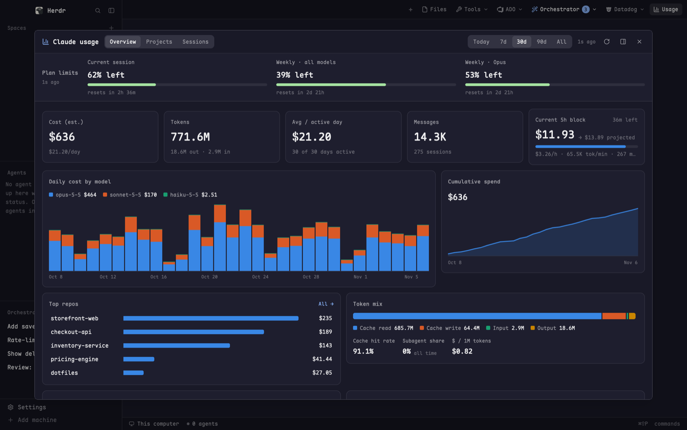

# Claude Code Usage

See what Claude Code costs you without leaving the terminal. Press `cmd-shift-u`
and a large dialog opens with your plan limits (5-hour window and weekly, % left
and when they reset), today's / this week's / this month's estimated cost and
tokens, a daily bar chart stacked by model, your top repos, an hour-of-week
heatmap and the live 5-hour block. Two more tabs break the same numbers down by
repo, folder, branch or model, and list sessions with a Resume link. Everything
comes from the transcripts Claude Code already writes; costs are estimates at
Anthropic list prices.

## What you see

The dialog is 90% of the window wide and 86% high, on `canvas` (falling back to
`surface`). Cards and tables sit on `background` with a 1px `border` and 10px
corners. Labels are `muted`, secondary text `dim`, figures `foreground`.

- **Header** (16px side padding, 10px vertical, 1px `border` below, wraps on
  narrow widths), left to right:
  - a 16px bar-chart icon in `accent` and "Claude usage" in 14px semibold;
  - tabs **Overview / Projects / Sessions** as a segmented control: pills 12px
    text, 6px corners, on a `raised` track with 8px corners; the active pill is
    `selected` with `foreground` text, others `muted` with a `hover` tint;
  - a spacer, then the range control **Today / 7d / 30d / 90d / All** (same look);
  - an 11px status: "scanning…", the report age ("2m ago"), or "scan failed" in
    `blocked`;
  - icon buttons (14px icons in `muted`, 5px padding, `hover` background):
    refresh (spins while scanning), and in the dialog only "Open beside this
    pane" and Close.
- **Plan limits row** (same padding, 1px `border` below, on `background`):
  "Plan limits" in 12px semibold `muted` with the fetch age under it in 10.5px
  (`dim`, or "stale · 3m ago" in `ansi3` when showing cached figures). Then one
  cell per limit, each at least 150px wide, sharing the row:
  - the label in 11.5px `muted` ("5-hour window", "Weekly", "Weekly · Opus",
    "Usage credits", …) and, right-aligned, a 10.5px semibold warning word;
  - "% left" in 17px semibold (or "$12.40 left" for usage credits);
  - a 6px bar (3px corners) on `foreground` at 8% alpha, filled to % **used**:
    `ansi2` under 75%, `ansi3` "Running low" from 75%, `ansi1` "Almost out" from 90%;
  - an 11px `dim` line: "resets in 3h 12m" (or "resets in 4d 6h" when two or more
    days away), or the credits note "$7.60 of $20.00 used".
  - With no figures at all the row reads "Unavailable: <reason>" in `dim`.
- **Body**, scrolling, 16px padding, 12px gaps, ending with a 10.5px `dim` note:
  "Estimated at Anthropic list prices · N messages in M transcripts · ~/.claude/projects".

**Overview**
1. **KPI tiles** (wrap, each ≥150px, 14px padding): "Cost (est.)", "Tokens"
   ("X out · Y in"), "Avg / active day" ("5 of 7 days active"), "Messages"
   ("N sessions"). Value 24px semibold, label and sub-line 11.5px. The cost
   sub-line is "▲ 12% vs previous 7d" when a full previous period exists, else
   "$X/day" (or "since Mar 4" on All). A fifth tile, "Current 5h block" (≥220px):
   cost, "→ $Y projected", "1h 40m left", a 6px progress bar of elapsed time, and
   "$/h · tok/min · msgs"; "—" / "no active block" when idle.
2. **Daily cost by model** (2/3 width) beside **Cumulative spend** (1/3). The
   bars are 150px high, stacked by the range's top 5 models plus "other" in
   `dim`, with a legend (9px swatches, 11.5px text, model cost) above and about
   8 sparse 10px date labels below; today's label is `foreground`. Ranges longer
   than 62 days use one bar per week ("Weekly cost by model"). Cumulative spend
   shows the total in 18px and a 110px line (2px stroke, 16% area tint) in
   series blue, with first and last dates under it.
3. **Top repos** (up to 7 rows: 150px name, 10px blue bar scaled to the top
   repo, 64px cost; "All →" in `accent` at the top right) beside **Token mix**:
   a 14px 100% strip of Cache read / Cache write / Input / Output with a legend,
   then three minis: cache hit rate, subagent share (all time), $ / 1M tokens.
4. **When you spend · last 30 days**: a Mon–Sun × 0–23h heatmap of 14px cells,
   blue at 18%–100% alpha by the square root of cost, empty cells `foreground` at
   5%; hour labels every 6h. Beside it **5-hour blocks**: the last 24 blocks as
   110px bars, the active one's label highlighted.

The two-card rows sit side by side at 980px wide and up; narrower, they stack.

**Projects**: "Group by" **Repo / Folder / Branch / Model**, then a table:
chevron, name (12.5px; sub-line 11px `dim` with the repo or path), a 120px
share bar (8px high, scaled to the top row), Cost (72px), Tokens (70px),
Msgs (56px), a 84×18px 14-day sparkline (from 760px wide) and "Last" active
(from 860px). A footer row gives the count and range totals. Grouped by model,
bars use the model's color; otherwise series blue. A repo row expands (▸/▾) to
a 70px daily chart (up to 60 days), its top 8 folders / worktrees (relative to
the repo as "./sub", or "⎇ name" for a worktree elsewhere) and top 8 branches,
and "Sessions in <repo> →".

**Sessions**: "N sessions" (or "N sessions · newest 150 shown"), an optional
repo filter chip with ✕, and a table: Last active (96px, "Nov 6 14:05"),
repo with branch (or folder) under it, model with an 8px color square,
length ("1h 05m"), cost with a 3px bar, tokens, and "Resume" in `accent`.

**Colors.** Series colors are a fixed categorical palette. Dark:
`#3987e5 #d95926 #199e70 #c98500 #d55181 #008300 #9085e9 #e66767`; light:
`#2a78d6 #eb6834 #1baf7a #eda100 #e87ba4 #008300 #6250d6 #e34948`. "Blue" above is
slot 1. Models take slots 1–6 by all-time cost, so a model keeps its color when
the range changes; models past 6 are `dim`.

## How it behaves

- **Open:** `cmd-shift-u` runs `mod.open:cc-usage` (a dialog). While the dialog
  is open the mod sets shared `cc-usage.open` to true, and false when it closes,
  so a tab-bar button can light up.
- **Panes:** "Open beside this pane" closes the dialog and splits the focused
  pane to the right with the mod in it. In a pane there are no dialog buttons.
- **Tabs, range, group** are remembered in the mod's `localStorage` (`tab`,
  `range`, `group`). Default: Overview, 30d, Repo.
- **Clicks:** a Top repos row jumps to Projects grouped by repo with that repo
  open; "All →" opens Projects; a repo row toggles its detail; "Sessions in
  <repo> →" opens Sessions filtered to it; the chip's ✕ clears the filter;
  "Resume" closes the dialog and opens a new tab in the session's folder running
  `claude --resume <id>`.
- **Hovers:** every bar, heatmap cell, strip part, limit cell and session row
  has a tooltip (day, cost, tokens, per-model split; limit "% used, % left,
  Resets Nov 6 18:00"; session folder and id).
- **Refresh:** the panel paints at once from the last saved report, then
  rescans. It rescans every 60s and refetches plan limits every 60s; reset
  countdowns repaint every 30s. The refresh button rescans now;
  shift-click drops the cache and rebuilds it from scratch.
- **Limits failing:** if the fetch fails the row keeps the last good figures,
  marked stale, with the reason as the tooltip.
- **Today / 7d / …** are calendar days in local time ending today. "All" runs
  from the first transcript.

## Built from

- **`mods/cc-usage/`**, `mod.json`:
  `{ "place": "none", "title": "Claude usage", "overlay": { "kind": "dialog", "width": 0.9, "height": 0.86 } }`
  - `main.js`: the view (one `View` class).
  - `charts.js`: native charts from `div`s: `bars` (stacked, with tooltips and
    sparse labels), `spark`, `line` (two `window.paint_path` layers built with
    `PathBuilder`), `strip`, `heatmap`, `legend`, and the palette.
  - `aggregate.py`: the scanner, run as `python3 aggregate.py [--full]`.
  - `limits.py`: the plan-limits fetcher, run as `python3 limits.py`.
  - Icons (24px stroke SVGs in `currentColor`): `gauge.svg` (bar chart),
    `refresh.svg`, `panel-right.svg`, `x.svg`.
- **`keys.json`**: `{ "global": { "cmd-shift-u": "mod.open:cc-usage" } }`.
- **Props** (all optional, pick the first view): `tab`, `range`, `group`, `repo`
  (session filter), `expand` (a repo key to open). `overlay` is set by herdr in
  the dialog.
- **herdr:** `exec`, `readTextFile`, `theme`, `settings` (`dark` picks the palette),
  `props`, `closeOverlay`, `home`, `appHome`, `setShared`, `run("pane.split",
  { direction: "right", mod: "cc-usage" })`, `run("tab.new", { folder, argv })`.
- **Programs:** `python3` (standard library only), `git` (repo lookup),
  `security` (macOS Keychain).
- **`aggregate.py`** reads every `*.jsonl` under `~/.config/claude/projects` and
  `~/.claude/projects` (or `$CLAUDE_CONFIG_DIR`, comma-separated). It keeps
  `type: "assistant"` lines with `message.usage`, skipping model `<synthetic>`,
  and stores a row per `message.id:requestId`: time, model, cwd, sessionId,
  gitBranch, input, output, 5m and 1h cache writes, cache reads, `speed: "fast"`,
  `isSidechain`. It prints one JSON report: per-day vectors
  `[cost, in, out, cacheWrite, cacheRead, msgs]` for all, each repo, folder,
  repo+branch and model; the newest 400 sessions; the last 40 5-hour blocks and
  the active one (burn rate, tokens/min, projected cost, minutes left); the
  30-day heatmap; subagent share. Cache in `~/.cache/cc-usage-herdr/`:
  `files.json` (rows and byte offset per transcript), `repos.json` (folder →
  repo), `report.json` (the last report), `lock`.
- **Costs**: a $/1M-token table (input, output, cache read) per model id, with
  prefix matching for dated ids and a family fallback; cache writes at 1.25× (5m)
  and 2× (1h) input; fast mode 2×. Unknown models cost 0.
- **`limits.py`** reads Claude Code's login with
  `security find-generic-password -s "Claude Code-credentials" -w`
  (`claudeAiOauth.accessToken`), calls `GET https://api.anthropic.com/api/oauth/usage`
  with `Authorization: Bearer …` and `anthropic-beta: oauth-2025-04-20`, and
  prints only `{fetched, limits: [{key, label, used, resets_at, left_text?, note?}]}`
  or `{error}`. It understands the newer `limits` list (`session`, `weekly_all`,
  `weekly_scoped` with a model or surface name) and the older keys (`five_hour`,
  `seven_day`, `seven_day_opus`, …), and adds "Usage credits" from `spend` when
  enabled. A good result is copied to `~/.cache/cc-usage-herdr/limits.json`.
- **Settings:** none from `addons.json`; no env vars needed. Edit the constants
  at the top of `main.js` (`REFRESH_MS`, `LIMITS_MS`) to change timing.

## Watch out

- **Dedupe twice.** Streaming repeats a message across lines, and resumed or
  forked sessions copy history into new files. Keep one row per
  `message.id:requestId`, the one with the most output tokens, within a file
  and again across all files, or costs double.
- **Incremental scan.** Transcripts are append-only: store the byte offset
  reached and only parse up to the last newline, leaving a half-written line for
  next time. Rescan from 0 if a file shrinks. Two copies of the mod can scan at
  once, so take an `flock` on the cache.
- **Cache writes:** older lines have only `cache_creation_input_tokens`; newer
  ones split it into `cache_creation.ephemeral_5m/1h_input_tokens`. Treat the
  plain total as 5m.
- **Worktrees fold into their repo:** use `git rev-parse --git-common-dir`; for
  folders that no longer exist, map `…/<repo>/.claude/worktrees/<slug>` to the
  repo and `…/worktrees/<name>/<slug>` to a known repo of that name. Cache the
  answers: the `git` calls are the slow part.
- **Bucket by local time**, not UTC: the day, the heatmap's weekday/hour and the
  5-hour block start (floored to the hour, as ccusage does; a new block starts
  after 5h from its start or a 5h gap).
- **The token stays in `limits.py`.** It is never printed, logged or cached; the
  JS only sees the figures. The endpoint is undocumented and its shape has
  changed once, so parse both shapes and fail soft with an `{error}` (exit 0).
  A 401 means the login expired: "run claude once to refresh it".
- **gpui:** pills and icon buttons stop `mouse_down` propagation so the dialog
  doesn't take the click as a drag. Every hoverable or tooltipped element needs
  a unique `.id()`. The `line` chart's paths use percentage coordinates so they
  scale with the card. Width-dependent columns come from `on_size_change`.
- **Caps:** 400 sessions in the report, 150 shown; 40 blocks kept, 24 drawn;
  7 top repos; 8 folders / branches per repo; 60 days in a repo's chart; top 5
  models stacked, 6 colored.
- **Assumes** macOS (Keychain), `python3` and `git` on the PATH, and Claude Code
  logged in with a subscription for the limits row. Without it the rest still works.
- Prices are hard-coded; update the table when Anthropic changes them.

## Done when

- `cmd-shift-u` opens the dialog and it fills with cost, tokens and charts from
  `~/.claude/projects` within a few seconds; `~/.cache/cc-usage-herdr/report.json`
  exists afterwards and the next open paints at once.
- A second scan with no new transcript lines parses no files (report `scanned` is 0).
- Switching range or tab, closing and reopening keeps the choice.
- The plan limits row shows "% left" and "resets in …" matching Claude Code's
  `/usage`; with the network off it shows the last figures marked stale.
- `python3 limits.py | grep -c accessToken` prints 0.
- Grouped by repo, a worktree's usage appears under its main repo.
- "Resume" opens a new tab in the right folder running `claude --resume <id>`.
- "Open beside this pane" moves it into a right-hand split; the shift-click
  refresh rebuilds the cache.
