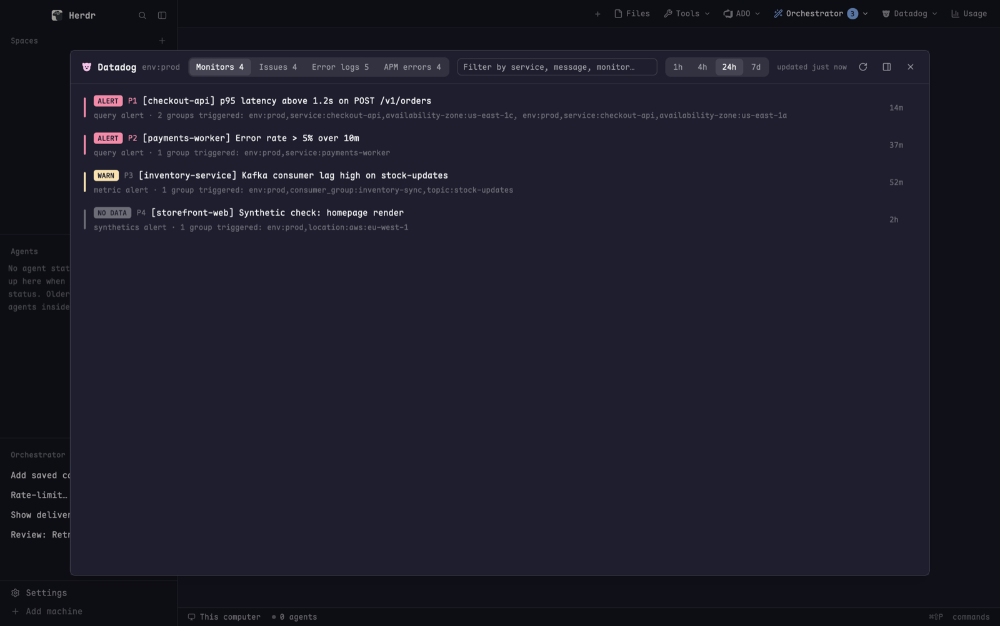

# Datadog Attention

One dialog that shows what needs attention in one Datadog environment:
triggered monitors, Error Tracking issues, error logs grouped by message, and
APM error spans. Each has its own tab with a count, over a 1h, 4h, 24h or 7d
window. Click a row to see its details and a link that opens it in Datadog.
Press `⌘⇧E`, or pick it from a small Datadog dropdown in the tab bar.

## What you see

- **The dialog**: 86% of the window wide, 84% high, on `surface`. It has a
  header strip and a scrolling list.
- **Header**: padding 16px across and 10px down, gap 12px, with a 1px `border`
  line below. It wraps onto more lines when the window is narrow. Left to right:
  - The Datadog logo (`datadog.svg`, 17px, `ansi5`), "Datadog" (14px
    semibold, `foreground`) and `env:<env>` (12px `dim`).
  - **Tabs**: a segmented control (`raised`, 8px radius, 2px padding) of
    pills: "Monitors N", "Issues N", "Error logs N", "APM errors N". Pills
    are 12px text, padding 10px by 3px, radius 6. The active pill is
    `selected` with `foreground` text. The others are `muted` text and show
    `hover` on hover. If a section failed to load, its count is replaced
    with "!". The Monitors count leaves out muted monitors.
  - **Filter box**: grows to fill the space, at least 160px wide, 26px high,
    on `background` with a 1px `input` border. Its placeholder is "Filter by
    service, message, monitor…".
  - **Window**: a second segmented control with the pills 1h / 4h / 24h / 7d.
  - **Status**: 11px. It says "loading…", "updated just now", "updated 5m ago"
    or "fetch failed" (in `blocked`); otherwise it is `dim`.
  - **Icon buttons** (14px `muted` icons, 5px padding, `hover` on hover):
    refresh, which spins while loading. When the mod is open as a dialog,
    two more follow: "Open beside this pane" (`panel-right.svg`) and Close
    (`x.svg`).
- **List**: 8px padding, rows 1px apart. Each row has 12px by 7px padding
  and is laid out as a 3px by 30px colored bar, then one or two text lines,
  then right-aligned columns. A row that is open gets a `raised` background,
  and its details are indented 27px below.
  - **Monitors**: a state badge, ALERT (`ansi1`), WARN (`ansi3`) or NO DATA
    (`dim`). The badge is solid with `background` text, unless the monitor is
    muted: then it is an outline, a MUTED badge is added, and the bar is `dim`.
    Next come `P1`…`P5` (`ansi1` for P1–P2, else `dim`) and the name in 13px.
    The second line holds the type and "N groups triggered: a, b, c". On the
    right is how long it has been in that state ("now", "12m", "3h", "2d").
    Open, it lists up to 12 triggered groups, each with its status badge and
    age, and an "Open monitor" button.
  - **Issues**: a solid NEW badge (`ansi1`) when the issue was first seen
    inside the window, then an outlined state badge: OPEN `ansi1`, FOR
    REVIEW `ansi3`, REVIEWED `ansi4`, IGNORED `dim`, RESOLVED `ansi2`. Then
    the error type (12.5px semibold `ansi1`) and the message. The second
    line is service · file · function. On the right: "1.2K×", "34 users"
    and last seen. Open, it shows the full message in the terminal font,
    first and last seen, the languages, and an "Open issue" button.
  - **Error logs**: a gray note on top, "12.3K error logs in 24h; clusters
    from the newest 1000". Each row is one cluster: the service (12px
    semibold `ansi4`), the error kind (`ansi1`) and the first line of the
    message. The second line is status · host · "first in sample 3h ago".
    On the right are the count and how long ago it last happened. The bar is
    `ansi5` for critical or emergency, otherwise `ansi1`. Open, it shows the
    message and an "Open in Log Explorer" button.
  - **APM errors**: one row per service and resource. It shows the service
    (`ansi4`), the resource, and the sample span's "Type: message" (or "no
    indexed sample span"). On the right: "N err" and the error rate, colored
    `ansi1` from 5%, `ansi3` from 1%, else `dim`. Hovering the rate shows a
    tooltip that explains it. Open, it shows the message and the stack trace
    in the terminal font (on `background`, scrolling, at most 260px), with
    "Open sample trace" and "Open service" buttons.
  - Link buttons are 11.5px `accent` text with a 1px `border` and radius 5.
- **Empty tab**: "✓ No monitors alerting in env:prod." centered, 12.5px,
  in `ansi2`.
- **No keys**: a centered "Connect Datadog" card, at most 620px wide. It says
  which env vars are missing and shows the `export DD_API_KEY=…` /
  `DD_APP_KEY` / `DD_SITE` lines to add to `~/.zshenv`. It names the
  Application key scopes needed (`monitors_read`, `error_tracking_read`,
  `logs_read_data`, `apm_read`) and has an "Open API keys page" button.
- **Errors**: if all four calls fail with 401 or 403, the panel says
  "Datadog rejected the keys" and shows the site. If one section fails, its
  tab shows "Couldn't load X", the API error, and "A 403 usually means the
  Application key lacks that scope." If the helper itself fails, the panel
  says "Couldn't run the Datadog helper". All of these headings are 13px
  `blocked`.
- **Dropdown (`dd-menu`)**: a 300×62 popup opened from a "Datadog" button in
  the tab bar. It has one row: the `alert.svg` icon (15px `muted`), "Needs
  attention" (12.5px `foreground`), "Monitors, issues, error logs, APM
  errors" below it (11px `dim`), and the bound key on the right ("⌘⇧E").

## How it behaves

- **Opening**: `⌘⇧E` (`mod.open:dd-attention`) or the dropdown row. The row
  closes the popup and then runs `mod.open`.
- **Refresh**: when the panel opens, every 120 s, when you press refresh, and
  when you change the window. A refresh never starts while another is still
  running. If you change the window while a fetch is running, that fetch's
  result is dropped.
- **Tabs**: on the first load with no saved tab, the panel picks the first tab
  that has rows.
- **Filter**: as you type, it filters the current tab, ignoring case. It
  matches monitor name, type, tags and group names; issue type, message,
  service, file and function; log service, message, kind and host; APM
  service, resource and sample type and message.
- **Rows**: click to open or close. Rows open on one tab stay open when you
  switch tabs, until the panel is closed.
- **Links** open in the browser through `open`, using
  `https://app.<site>` for `datadoghq.com` and `datadoghq.eu`, and
  `https://<site>` for other sites. Log Explorer and service links carry the
  current window as `from_ts`/`to_ts`. The Log Explorer query is
  `service:<svc> status:error env:<env> "<message start>"`.
- **"Open beside this pane"** closes the dialog and runs `pane.split` with
  `{direction: "right", mod: "dd-attention"}`.
- **Remembered**: the window (`hours`) and the tab, in the mod's
  `localStorage`. The filter text is not kept.

## Built from

- **`mods/dd-attention/`**
  - `mod.json`: `{ "place": "none", "title": "Datadog", "overlay": { "kind":
    "dialog", "width": 0.86, "height": 0.84 } }`
  - `main.js`: the view. It imports `exec`, `theme`, `settings` (for
    `font_family`), `props` (for `overlay`), `closeOverlay`, `run`, `notify`
    and `appHome` from `herdr`, plus `readFile` from `fs/promises`.
  - `dd.py`: the data helper (Python standard library only). `main.js` runs
    it with
    `exec("/bin/zsh", ["-lic", "exec python3 -I '<appHome>/mods/dd-attention/dd.py' --env '<env>' --hours <n>"])`.
    It prints the line `@@DD-ATTENTION@@` and then one JSON object, and
    `main.js` parses whatever comes after the last marker.
  - Icons: `datadog.svg`, `refresh.svg`, `panel-right.svg`, `x.svg`, all
    24×24 using `currentColor`.
- **`dd.py`** reads `DD_API_KEY` (or `DATADOG_API_KEY`) and `DD_APP_KEY` (or
  `DD_APPLICATION_KEY` / `DATADOG_APP_KEY`), plus `DD_SITE` (default
  `datadoghq.com`). It calls `https://api.<site>` with `DD-API-KEY` /
  `DD-APPLICATION-KEY` headers, with a 25 s timeout per call. It runs four
  jobs in parallel:
  - **monitors**: `GET /api/v1/monitor?group_states=alert,warn,no data&with_downtimes=true`,
    500 per page, at most 10 pages. It keeps Alert, Warn and No Data. A
    monitor is dropped when its tags or query name an `env:` other than this
    one. A monitor is muted when it has a matching downtime or
    `options.silenced`. Sort order: unmuted first, then Alert, Warn, No Data,
    then priority, then name.
  - **issues**: `POST /api/v2/error-tracking/issues/search?include=issue`,
    query `env:<env>`, `order_by: TOTAL_COUNT`, `persona: ALL`.
  - **logs**: `POST /api/v2/logs/events/search` for
    `status:(error OR critical OR emergency OR alert) env:<env>`, newest first,
    up to 1000 events. It also calls `POST /api/v2/logs/analytics/aggregate`
    for the total count per service (top 25). To build the clusters, it takes
    the first line of each message, replaces UUIDs with `<uuid>`, hex strings
    of 16+ characters with `<hex>` and digits with `#`, and groups by service
    plus that text.
  - **apm**: `POST /api/v2/spans/analytics/aggregate` twice. The first counts
    errors by service (top 20) × resource (top 5). The second counts all spans
    by service (top 50), which gives the rate. Then
    `POST /api/v2/spans/events/search` fetches the 200 newest error spans and
    keeps one sample per service and resource.
  - Output: `{generated, site, env, hours, monitors|issues|logs|apm: {ok, data|error}}`,
    or `fatal: "missing_keys"` (with `missing`) or `fatal: "auth"`.
- **Settings**: `datadog.env` from `~/.config/herdr-app/addons.json` (default
  `prod`), re-read before each refresh. Before use, every character except
  `[\w.:-]` is removed from it.
- **`mods/dd-menu/`**
  - `mod.json`: `{ "place": "none", "title": "Datadog", "overlay": { "kind":
    "popup", "width": 300, "height": 62 } }`
  - `main.js` has an `ITEMS` list (`mod`, `title`, `about`, `icon`). The key
    hint comes from `keys()`: the binding whose action is
    `mod.open:<mod>`, drawn with ⌘⇧⌥⌃ glyphs. It uses `props`,
    `closeOverlay`, `run`, `theme` and `keys`.
  - `alert.svg` (the row icon) and `datadog.svg`, used by the tab bar
    button.
- **Tab bar button** (in the `my-tabs` mod, not in this folder): a 26px pill
  with the `chrome` background and `muted` 12px text: the Datadog logo, then
  "Datadog", then a chevron. It runs
  `openOverlay({ mod: "dd-menu", kind: "popup", width: 300, height: 62 })`.
- **`keys.json`**: `{ "global": { "cmd-shift-e": "mod.open:dd-attention" } }`.
- **Programs**: `/bin/zsh`, `python3`, `open`.

## Watch out

- **Not yet tested against a real Datadog account.** The request bodies and
  response parsing follow Datadog's API docs. Check them against a live org
  first, especially the Error Tracking search and the spans aggregate shapes.
  The code reads both `attributes.compute` and `computes`, because the docs
  are unclear about which one comes back.
- The keys only reach Python through a login, interactive shell (`zsh -lic`).
  herdr's own environment does not have them. Shell start-up output can land
  on stdout, which is why the JSON comes after a marker. Run `python3 -I`. The
  keys must never be printed, logged or put in `addons.json`.
- `herdr` loads icons from `mods/<name>/…` paths relative to the herdr-app
  home. A symlinked mod folder does not load its icons, so copy it.
- Pills, icon buttons and link buttons call `cx.stop_propagation()` on
  `on_mouse_down("left")`. Without that, a click falls through to the row or
  dialog behind.
- If the refresh timer fires while a fetch is still running, it skips.
  Results for an old window are dropped (`hours !== this.hours`).
- **Caps**: 100 issues, 150 log clusters (from the newest 1000 error logs
  only, so "first in sample" is not the real first time), 100 APM rows, 20
  groups per monitor (12 shown when open), messages cut at 400 characters,
  stack traces at 4000.
- "Datadog rejected the keys" appears only when all four calls fail with
  401 or 403. If only some fail, each of those tabs shows its own error.
- If you add rows to `dd-menu`, make the popup height in `my-tabs` 52px per
  row plus 10.
- It assumes macOS (`open`, `/bin/zsh`) and `python3` on the login shell's
  PATH.

## Done when

- `herdr-app check` passes for `dd-attention` and `dd-menu`.
- With no `DD_API_KEY`, `⌘⇧E` opens the dialog and shows "Connect Datadog"
  with "Missing: DD_API_KEY, DD_APP_KEY."
- `python3 dd.py --env prod --hours 1` (without keys) prints the marker line
  and then `{"fatal": "missing_keys", …}`.
- With valid keys, the tabs show counts, and an empty tab shows the green ✓
  line.
- Switching to 7d reloads the data, and that choice and the tab are still
  set after the dialog is closed and opened again.
- Typing in the filter narrows the current tab right away.
- "Open monitor" opens `https://app.datadoghq.com/monitors/<id>` in the
  browser.
- "Open beside this pane" replaces the dialog with a pane on the right.
- The tab bar's Datadog button opens the dropdown. "Needs attention" shows
  `⌘⇧E` and opens the dialog.
