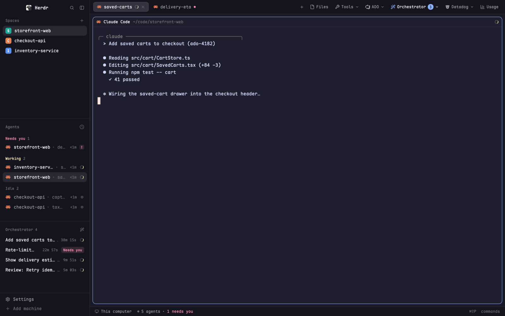

# My Main

herdr's main layout with a busier tab bar. The sidebar on the left lists spaces,
agents and the sessions running in a local agent orchestrator. The bar across the
top keeps herdr's tabs, then adds Tools, ADO, Orchestrator, Datadog and Usage
buttons that open dropdowns or dialogs from the other addons in this repo. When an
orchestrator plan or permission request starts waiting for you, a notification
pops up, the blocked sound plays and the Orchestrator button shows a count.

## What you see

The window is a row on `canvas` with 1px `border` dividers, no title bar, and the
macOS traffic lights at (12, 16). Terminals get 14px x 12px padding.

**Sidebar** (left, 268px, `chrome`, not resizable; min 44, max 480), top to bottom:

- **Brand**, 46px: herdr's shipped `workspace-chrome`. You can drag the window by it.
- **Spaces** (shipped `spaces`), weight 1, min 90px.
- **Agents** (shipped `agents`), weight 1, min 90px.
- **Orchestrator** (`orch-sidebar` from this repo's orchestrator addon), weight 0.7,
  min 90px: the orchestrator's running sessions.
- **Footer**, 69px: `workspace-chrome` with `footer: true`.

**Work area** (the rest of the width), top to bottom:

- **Tab bar**, 42px, `chrome` with a 1px `border` line under it; you can drag the
  window by it. It has 10px side padding and 3px gaps. On macOS with no title bar
  and not fullscreen, its left padding grows to clear the traffic lights:
  `max(10, (traffic_lights[0] + 64) / zoom − sidebar width)`, using 0 for a hidden
  sidebar. From left to right:
  - **Tabs**, in a strip that scrolls sideways. Each tab is 29px high, 10px side
    padding, 7px gap, 7px corners, 12.8px text. The active tab has a 1px `border`
    outline, `raised` fill and `foreground` text; the others have `chrome` fill and
    outline and `muted` text. A tab shows its program's 14px icon (tinted `muted`
    when the icon is a tint icon), then its name truncated at 170px. A tab named
    `tb<number>` (herdr's default) shows its program's name instead, or "Terminal".
    A zoomed tab gets " Z" after its name. A working tab shows a 12px spinner in
    `working`; a blocked or done tab shows a 6px dot in `blocked` or `done`. Only
    the active tab shows a 12px close X in `dim`.
  - **+**, a 26px square in `dim` (hover: `hover` fill, `foreground` text).
  - **Files**, only when `files` is among the enabled side panels.
  - **Tools**, **ADO**, **Orchestrator**, **Datadog**, **Usage**: each 26px high,
    8px side padding, 5px gap, 6px corners, 12px text in `muted` on `chrome`, a 14px
    icon before the label and an 11px chevron after it (Usage has no chevron).
    Hover fills `hover`.
    - Files and Usage are lit (`selected` fill, `foreground` text) while their panel
      or dialog is open.
    - Orchestrator: when approvals are waiting, its wand icon turns `done`, the label
      turns `foreground`, and a badge follows the label: the count in 10.5px
      `background` text on a `done` pill (5px side padding, 8px corners). While the
      orchestrator can't be reached, the wand is `dim`.
  - **Window buttons** (minimize, maximize/restore, close), 26px squares in `dim`,
    only on platforms where herdr asks for them (not macOS). On Windows they are
    16px line icons; elsewhere "−", "□" and a 13px X.
- **Body**, a row with 8px padding and 8px gap:
  - **Main**: the active tab's panes. Each pane has the shipped `pane` header (30px,
    always shown, on top), `background` fill, a 1px `border` outline (1px `accent`
    when focused), 10px corners, 8px between panes, and the same frame for a lone
    pane.
  - **Side panel**, hidden by default: 368px (min 280, max 900), a stack of the
    shipped `files` and `changes`, `files` on top.
- **Status bar**, 28px: shipped `workspace-status`.

**Tools dropdown**: a 300 x 168 popup with 5px padding. Three rows (9px x 7px
padding, 10px gap, 6px corners, `hover` on hover): a 15px icon in `muted`, a title
in 12.5px `foreground` over a line in 11px `dim`, and the bound key on the right in
11px `dim` (like `⌘⇧G`; blank when nothing is bound).

| Row | Line under it | Icon | Opens |
|---|---|---|---|
| Git Glance | Status, diff, branches, stashes | git branch | `git-glance` |
| Git Glance in a pane | Beside the current terminal | split pane | `git-glance-pane` |
| Project Runner | Run a package.json script | play | `project-runner` |

## How it behaves

- **Tabs:** click selects. Drag one tab onto another to move it there. Double-click
  renames. Right-click opens herdr's `menu` popup (200px wide) for that tab. The
  close X closes the active tab. Scrolling the wheel over the bar switches tabs
  (`tab.prev` for a positive `delta.y`, `tab.next` for a negative one; deltas
  under 1 are ignored).
- **+** opens the shipped `new-menu` popup (250 x 512).
- **Files** toggles the side panel on the Files view.
- **The side panel is remembered per space.** Switching to a space restores that
  space's last panel (or closes it if that space never had one recorded); opening or
  closing it records the choice in localStorage `panels`. For 1 second after a
  restore, the old state isn't recorded as a choice.
- **Dropdowns** open as popups: Tools (300 x 168), ADO `ado-menu` (300 x 218),
  Orchestrator `orch-menu` (300 x 218), Datadog `dd-menu` (300 x 62). Picking a Tools
  row closes the popup and opens that mod.
- **Usage** opens or closes the `cc-usage` dialog. Tooltip: "Claude usage (⌘⇧U)".
- **Orchestrator poll**, on load and then every 15 s (skipped while one is still
  running):
  - It asks the orchestrator for pending plan approvals, sessions and the PR inbox.
    "Waiting" means plans waiting for approval plus sessions halted on a permission.
    The PR inbox only feeds the counts.
  - Each newly waiting item posts a `warning` notification for 15 s: "Plan waiting
    for approval" (`<item id> · <title>`) or "Agent needs a permission"
    (`<workflow id> · <permission title or "tool call">`). At most 3 are posted; past
    that, one more says "N more orchestrator approvals". Clicking any of them opens
    the `orch` dialog.
  - If anything new turned up, it plays the `blocked` sound and sets shared
    `orch.want` to `"approvals"`, so the `orch` dialog opens on its Approvals tab.
  - It always publishes shared `orch.counts` = `{sessions, approvals, prs}` (prs:
    review requests that still need your review). `orch-menu` shows these numbers.
  - The keys it has already announced persist in localStorage `orch.seen`, so a
    restart doesn't announce them again.
  - Badge tooltip: "N waiting on your approval", "Orchestrator" when nothing waits,
    "Orchestrator (offline)" when the last poll failed.

## Built from

- **`layouts/my-main.json`**, cloned from herdr's `main` 0.1.12 (`cloned_from`).
  Node tree:
  - `root` row: `background: canvas`, `divider {width 1, color border}`,
    `titlebar: none`, `traffic_lights [12, 16]`, `terminal_padding [14, 12]`.
    - `sidebar` column, `{px 268}`, min 44, max 480, `background: chrome`,
      `resizable: false`:
      - `brand` block, mod `workspace-chrome`, `{px 46}`, `window_drag`.
      - `sidebar-lists` column: `spaces` (mod `spaces`, weight 1, min 90),
        `agents` (mod `agents`, weight 1, min 90), `orchestrator` (mod
        `orch-sidebar`, weight 0.7, min 90).
      - `sidebar-footer` block, mod `workspace-chrome` with props `{footer: true}`,
        `{px 69}`.
    - `work` column, `resizable: false`:
      - `tabs` block, mod `my-tabs`, `{px 42}`, `window_drag`.
      - `work-body` row, `padding 8`, `gap 8`:
        - `main` block, content `{tab: "active", pane: {...}}`: header mod `pane`,
          `reveal: always`, height 30, position top; `background: background`;
          border 1 `border`; focus 1 `accent`; radius 10; gap 8; `lone: true`.
        - `panel` column, `{px 368}`, min 280, max 900, `hidden: true`, holding the
          `panel-body` stack (`files`, `changes`; active `files`).
      - `status` block, mod `workspace-status`, `{px 28}`.
- **`mods/my-tabs/`**, a clone of herdr's shipped `tabs` 0.1.12. `mod.json`:
  `{"place": "none", "title": "Tabs", "cloned_from": {...}}`. No props.
  - herdr: `spaces`, `panes`, `layout`, `window`, `settings`, `theme`, `shared`,
    `setShared`, `openOverlay`, `run`, `exec`, `notify`, `playSound`, `appHome`,
    `localStorage`, `cx.timer.every`, `cx.spawn`; `fs/promises` `readFile`.
  - Commands: `tab.select`, `tab.move`, `tab.rename`, `tab.close`, `tab.prev`,
    `tab.next`, `layout.select` (`stack: panel-body`), `layout.show` /
    `layout.hide` (`id: panel`), `mod.open`, `window.minimize`,
    `window.maximize`, `window.close`.
  - Reads shared `workspace.panels` (default `["files", "changes"]`) and
    `cc-usage.open` (set by `cc-usage`); writes `orch.counts` and `orch.want`.
  - Program: `curl -q --noproxy "*" -sf -m 10 <url>`. Endpoints on the
    orchestrator: `GET /v1/approvals` (`pending_approvals[]`: `item_id`,
    `planned_revision`, `title`), `GET /v1/sessions` (`sessions[]`: `session_id`,
    `workflow_id`, `awaiting_permission`, `permission_title`,
    `permission_tool_input`), `GET /v1/pr-inbox` (`review_requests[]` with
    `needs_review`; a failure here is ignored).
  - Setting: `orchestrator.url` from `~/.config/herdr-app/addons.json` (via
    `appHome()`), read before every poll, trailing slashes stripped; default
    `http://127.0.0.1:8490`.
  - Notification keys: `plan:<item_id>:<planned_revision>` and
    `ask:<session_id>:<permission_title>:<permission_tool_input>`, so a re-planned
    item or a new permission on the same session announces again.
  - Art: `win-min.svg`, `win-max.svg`, `win-restore.svg`, `win-close.svg` (16px,
    1px stroke, `currentColor`).
- **`mods/tools-menu/`**. `mod.json`:
  `{"place": "none", "title": "Tools", "overlay": {"kind": "popup", "width": 300, "height": 168}}`.
  - herdr: `props` (`overlay`, to close itself), `closeOverlay`, `run("mod.open")`,
    `theme`, `keys` (finds the binding whose action is `mod.open:<mod>` and draws it
    with ⌘ ⇧ ⌥ ⌃ glyphs).
  - Art (Lucide-style, 24px viewBox, 2px stroke, `currentColor`): `git.svg`,
    `pane.svg`, `play.svg` for the rows; `wrench.svg` and `chevron-down.svg` for
    the tab bar.
- **Shipped herdr mods it uses:** `workspace-chrome`, `spaces`, `agents`, `pane`,
  `files`, `changes`, `workspace-status`, `new-menu`, `menu`. Icons borrowed from
  them: `mods/workspace-chrome/spinner.svg`, `mods/pane/close.svg`,
  `mods/files/file.svg`.
- **Other addons in this repo it needs** (install them too):
  - `orchestrator`: `orch-sidebar` (in the layout), `orch-menu` (dropdown, and its
    `wand.svg` on the button), `orch` (opened by notifications).
  - `azure-devops`: `ado-menu` (dropdown, and its `ado.svg`).
  - `datadog`: `dd-menu` (dropdown, and its `datadog.svg`).
  - `cc-usage`: `cc-usage` (dialog, its `gauge.svg`, and the `cc-usage.open` flag).
- **Outside this repo:** `git-glance`, `git-glance-pane` and `project-runner` come
  from github.com/JacobAtchley/herdr-plugins.

## Watch out

- `my-tabs` loads icons from other mods' folders by path (`mods/orch-menu/wand.svg`,
  `mods/ado-menu/ado.svg`, `mods/dd-menu/datadog.svg`, `mods/cc-usage/gauge.svg`).
  A missing folder means a missing icon and a button that opens nothing. Drop the
  button if you don't install that addon.
- Every dropdown in the bar uses `mods/tools-menu/chevron-down.svg`, so
  `tools-menu` must be installed even if you don't want its menu.
- Copy mods into `~/.config/herdr-app/mods/`; don't symlink them. herdr won't load
  a mod's icons through a symlink.
- Buttons stop clicks on mouse-down (`cx.stop_propagation`) so the press doesn't
  reach the bar, which is a `window_drag` region.
- Tab dragging is done by hand: mouse-down remembers the tab, mouse-up on another
  tab runs `tab.move` to that tab's index + 1, and mouse-up anywhere else on the bar
  clears it.
- The panel memory has to wait out its own restore: right after it runs
  `layout.show`/`layout.hide`, the layout still shows the old state for a moment.
  Without the 1 s `pending` guard it records that old state as the choice. It also
  doesn't restore on the very first render for a space it has no record of.
- Only Files gets a tab-bar button; Changes is in the side stack but has no button
  here.
- Popup sizes are set in two places: `openOverlay` in `my-tabs` and the dropdown's
  own `mod.json`. Keep them in step (Tools is 300 x 168, three rows).
- The orchestrator is optional. When it's unreachable, the poll fails quietly, the
  button stays usable and the tooltip says offline. The first run with an empty
  `orch.seen` announces everything already waiting (up to 3 + a summary).
- `my-tabs` and the layout are copies of herdr 0.1.12's `tabs` and `main`. They
  don't get herdr's later fixes to those.
- No secrets: the orchestrator is called without auth. Its URL comes only from
  `addons.json`.

## Done when

- `herdr-app check` passes for `my-tabs` and `tools-menu`, and
  `layout.switch my-main` shows the 268px sidebar with Spaces, Agents and
  Orchestrator lists and the 42px tab bar.
- The bar shows tabs, +, Files, Tools, ADO, Orchestrator, Datadog and Usage, each
  with its icon; the four dropdowns open at the sizes above.
- Tools lists Git Glance, Git Glance in a pane and Project Runner with their bound
  keys, and clicking a row closes the popup and opens that mod.
- Clicking, dragging, double-clicking and right-clicking tabs select, move, rename
  and open the tab menu; the wheel switches tabs.
- Open Files in one space, switch to another space and back: each space keeps its
  own panel state.
- With an orchestrator at `orchestrator.url` and one pending plan, within 15 s a
  "Plan waiting for approval" notification appears, the blocked sound plays, the
  button shows a `1` badge, and clicking the notification opens `orch` on
  Approvals. Restarting herdr doesn't announce it again.
- With no orchestrator running, the button's tooltip reads "Orchestrator
  (offline)" and nothing else breaks.
- Opening the Usage dialog lights the Usage button; closing it un-lights it.
