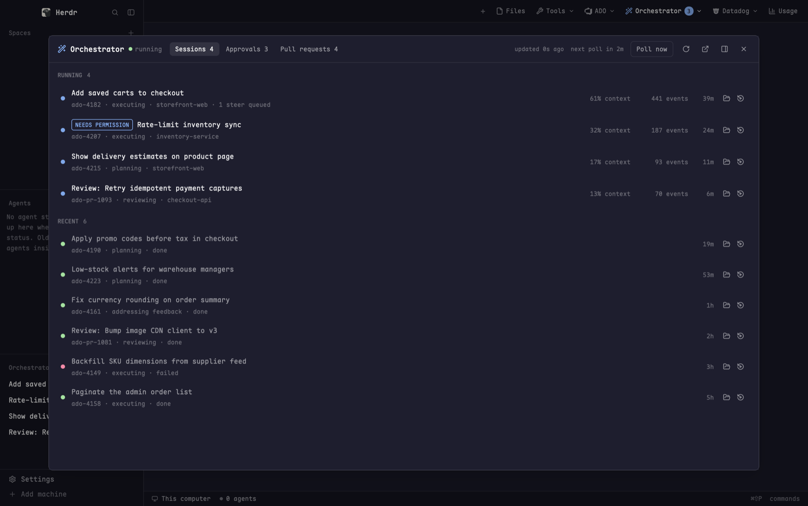

# Orchestrator Inbox

A window onto a local agent-orchestrator daemon that runs coding agents
for you. A big dialog has three tabs. **Sessions** lists the agents running
now and the ones that finished recently; open one to read its transcript and
steer it. **Approvals** shows plans waiting for your sign-off and agents
stopped on a tool permission, with Approve, Reject and Deny buttons.
**Pull requests** is your review queue and your own PRs. A small dropdown
from the tab bar opens the dialog on any of these tabs. A sidebar list shows
the running sessions with a ticking clock, and says "Needs you" when one is
waiting on a permission.

## What you see

### The dialog (`orch`), 88% x 86% of the window, on `surface`

- **Header**, 10px/16px padding, 1px `border` below, wraps on narrow widths:
  - a 16px wand icon in `accent`, "Orchestrator" at 14px semibold
  - a 7px status dot (`ansi2` once connected, `blocked` when offline, `dim`
    before the first fetch) and the daemon's `status` string in 12px `dim`
    ("connecting…" or "offline" otherwise)
  - tab pills on a `background` track (2px padding, 8px radius): Sessions,
    Approvals, Pull requests. Each is 12px, 10px x 3px padding, 6px radius.
    The active pill is `foreground` on `selected`, the others `muted`. A pill
    shows its count when it is above zero, e.g. "Approvals 2".
  - on the right, in 11px `dim`: "updated 12s ago" and "next poll in 4m"
  - a **Poll now** text button, then 14px icon buttons: refresh (spins
    while loading), open the web dashboard, dock as a right pane, close.
    The last two only show when it is open as an overlay.
- **Sessions tab**, sections with 11px semibold uppercase `dim` headings and
  a count:
  - **Running**: one row per live session (10px x 8px padding, 6px radius,
    `hover` background). An 8px dot pulses (opacity 0.35 to 1 over 1.2s):
    `accent` when working, `done` when waiting on a permission. Then a
    "NEEDS PERMISSION" badge if waiting, the workflow's title at 13px, and a
    11.5px `dim` line: workflow id · phase · repo · "1 steer queued". On the
    right are fixed columns: "% context" (90px, turns `done` above 80%),
    "N events" (96px), age (36px, "42s", "5m", "3h", "2d"), then two icon
    buttons: open the worktree folder, and resume in Claude Code.
  - **Recent**: up to 30 finished sessions from the history, newest first.
    The dot is `ansi2` when the outcome is "done", `blocked` for any other
    outcome, `dim` when there is none. The title is in `muted`, then
    workflow id · phase · outcome, the age and the same two icon buttons.
  - Empty states: "No sessions running.", "Nothing finished recently."
- **Transcript** (a session opened):
  - a bar with a back arrow, an 8px dot (`accent` live, `dim` finished), the
    title at 13px semibold and a line: workflow id · phase · live/finished ·
    the latest usage text · "newest 400 events" when cut off. Then a
    "● Live tail" / "○ Live tail" pill and an "Open in dashboard" button.
  - if the session is waiting on a permission, its ask card (see Approvals)
  - the events, oldest at the top. Each row has a 52px `HH:MM:SS` time in
    10.5px `dim`, a 12px mark and the text:

    | kind | mark | color | text |
    |---|---|---|---|
    | message | › | `foreground` | text |
    | thought | ∴ | `dim` | text |
    | tool_start | $ | `accent`, mono | the tool's command or path |
    | permission / permission_pending | ? | `done`, mono | "asks: …" |
    | permission_approved | ✓ | `ansi2`, mono | "approved: …" |
    | permission_denied | ✗ | `blocked`, mono | "denied: …" |
    | session_start | ▶ | `dim` | text |
    | state_change | → | `accent`, semibold | "FROM → TO" |
    | result | ■ | `ansi2`, semibold | text |
    | steering | ↪ | `ansi5` | "steer: …" |
    | plan | ☰ | `muted` | text |
    | error | ! | `blocked` | text |

    Mono text uses the terminal font at 11.5px and is cut at 600
    characters. Other text is 12.5px. With live tail on, each event is a
    single 22px line, with newlines shown as " ⏎ ". With it off, rows
    wrap to their full height.
  - for the first live session only: a steer box at the bottom (30px input
    on `background` with an `input` border, placeholder "Steer this
    session… (sent after its current step)") and a filled `accent` Send
    button.
- **Approvals tab**:
  - **Agents waiting on a permission**: one card each, 10px padding, 8px
    radius, `done` border on `done` at 8% alpha. It shows a badge
    "PERMISSION · EDIT" (the permission kind), the ask title at 13px
    semibold, and the time left ("42m left", in `blocked` under 5 minutes,
    "expired" at zero). Below are workflow id · phase · title, the tool
    input in a mono box on `background` (cut at 1200 characters), and
    "Why it asked: …" in `muted`. Buttons: Approve (filled `ansi2`), Deny
    (`blocked` outline), and "Open session" unless that transcript is
    already open.
  - **Plans waiting for approval**: cards with a `done` border on `surface`.
    Each has a "PLAN" badge, the title, and "item id · repo" on the right. A
    `blocked` notice shows when the work item changed after planning
    ("revision 3 → 5"). An `accent` "Read the plan" toggle opens the plan's
    DESIGN.md and PLAN.md. Each file is a collapsible section (chevron, name,
    "N lines") with a Rendered/Source switch and a full-screen button. The
    body is Markdown, up to 560px tall and scrolling, on `background`.
    Buttons: Approve (filled `ansi2`), Reject (`blocked`), then on the right
    "Workflow" (dashboard page) and "Work item" (the item's URL).
- **Pull requests tab**:
  - a line "Inbox refreshed 3m ago" (or "Inbox error: …" in `blocked`) and a
    "Refresh from ADO" button
  - **Needs your review**, **Your PRs**, and a collapsed "ALREADY VOTED OR
    NOT NEEDED N" toggle. Each PR row has badges as they apply (DRAFT `dim`,
    REQUIRED `accent`, "via <group>" `dim`, FEEDBACK WAITING `done`,
    AUTO-ADDRESSED `ansi2`, and the agent workflow's state, colored by
    `stateColor`). Then the title at 13px (`muted` for drafts) and
    repo · !id · source → target in `dim`. On the right: the author for a
    review, or your vote for your own PR (130px), thread counts as
    `●open` in `done` and `✓resolved` in `ansi2` (64px, "—" when none),
    the age (32px), and for reviews a 128px slot. That slot holds a
    "Review with agent" button, or "claimed by Alex Kim", or nothing when
    a workflow already exists. Last is an open-in-browser icon.
  - "The PR inbox is off…" when the daemon reports `enabled: false`.
- **Offline**: below the header, centred: "Can't reach the orchestrator" in
  `blocked`, the error, and "Is the daemon running at <url>? (orchestrator.url
  in addons.json)".

### The plan reader (`orch` with `{doc}`), 92% x 92%

A header holds a filled `done` "PLAN" tag, the title at 14px semibold, a
DESIGN.md / PLAN.md switch on `raised`, the Rendered/Source switch and a
close button. Below it the Markdown is 14px, centred in a column up to
960px wide with 28px x 20px padding.

### The dropdown (`orch-menu`), a 300 x 218 popup

There are four rows, each 9px x 7px padding with 6px radius and `hover`
on hover. Each row has a 15px icon, a 12.5px `foreground` title over an
11px `dim` description, and a count pill:

- Sessions: "Running and recent agent sessions"
- Approvals: "Plans and permission asks waiting on you". When the count is
  above zero, its icon is `done` and the pill is filled `done` with
  `background` text.
- Pull requests: "Your review queue and your PRs"
- Dashboard: "Open the web dashboard in your browser", with a 12px external
  icon instead of a count

Other pills are `muted` text on `selected`. Icons are `muted` unless hot.

### The sidebar list (`orch-sidebar`)

It sits on `chrome` with a 1px `border` on top, at 13px. The header is 41px:
"Orchestrator" in 11.5px medium `dim`, the count, and a 13px wand icon on the
right. Each session row is 30px with 8px radius. It shows the title (max
150px, `foreground`), "· phase" in `dim`, the elapsed time in 11px `dim`
("42s", "4m 12s", "1h 05m") and either a 12px spinner in `working` turning
every 900ms, or a "Needs you" tag (18px tall, 10.5px semibold `blocked` on
`blocked` at 15% alpha). Empty states: "Orchestrator offline." and "No
sessions running.".

## How it behaves

- **Polling.** The dialog re-reads status, sessions, workflows, approvals,
  history (120) and the PR inbox every 5s. Only `/v1/status` failing marks
  it offline. The other lists keep their last value on error. It also
  fetches the pending permission for each session that is waiting. An open
  live transcript re-reads every 3s. The sidebar reads sessions every 5s
  and workflow titles every 30s, or at once when a session's title is
  unknown. Its clocks repaint every second while anything runs.
- **Counts** (sessions, approvals = plans + permission asks, PRs needing
  review) are written to `shared("orch.counts")` so the dropdown can show
  them.
- **Opening tab.** From the dropdown it is `props.tab`. A notification click
  opens it with no props, so it uses `shared("orch.want")` (cleared once
  read). Otherwise it is the last tab, from `localStorage` key `tab`. The
  default is Sessions. `props.session` opens straight into that transcript.
- **Clicks.** A session row opens its transcript and the back arrow returns.
  A PR row opens the PR's URL with `open`. "Open in dashboard", "Workflow"
  and the external icon open dashboard pages (`/`, `/sessions/<id>`,
  `/workflows/<item>`). Markdown links that start with http(s) open in the
  browser.
- **Live tail.** Every transcript opens tailing: scrolled to the newest
  event, and kept there on each reload. Scrolling the wheel up turns it
  off. Clicking the pill turns it back on and jumps to the end.
- **Two-click confirm.** Approve and Reject on a plan arm on the first click
  ("Click again to approve") and fire on a second click within 3s. Resume
  on a live session asks the same way ("Still running under the
  orchestrator: click again to resume it anyway").
- **Actions** show "…" while busy, report errors in `blocked` under their
  row, and refresh afterwards. Toasts appear for "Plan approved", "Review
  dispatched" (with the new item id), "Steer sent" and "Orchestrator
  polling".
- **Poll now** asks the daemon to poll its sources at once, then re-reads
  after 4s and 15s.
- **Folder / Resume.** These open a new tab named "WT <id>" or
  "Resume <id>" in the session's folder. The folder is the workflow's
  `worktree_path` if it exists. If not, it is the `cwd` recorded in
  `~/.claude/projects/*/<session>.jsonl`. Resume runs `claude --resume
  <session> --model <model>`. With no folder found, a warning says it may
  have been cleaned up. Either action closes the dialog.
- **Dock** closes the dialog and reopens the same tab and session as a
  pane split to the right.
- **Sidebar.** A row click opens the dialog on that session's transcript.
  The wand opens it on Sessions. Hovering a row shows the title,
  workflow · phase, and "Waiting on: …".
- **Dropdown.** It closes itself, then opens the dialog on the chosen tab,
  or opens the dashboard URL in the browser.

## Built from

- **`mods/orch/`**, `mod.json`:
  `{"place": "none", "title": "Orchestrator", "overlay": {"kind": "dialog", "width": 0.88, "height": 0.86}}`
  - `main.js`: the dialog and the plan reader. Props are `tab`
    (`sessions`|`approvals`|`prs`), `session` (session id), `doc`
    (`{item, file, title}`, which switches to the reader) and `overlay`.
  - `api.js`: every daemon call goes through
    `curl -q --noproxy * -sS -m 12 -X <method> -H content-type:application/json [--data-binary <json>] -w "\n%{http_code}" <url>`.
    It treats 2xx as success. On failure it reports the body's
    `error`/`message`/`detail` or "HTTP <status>".
  - icons (Lucide, 24px viewBox, `stroke="currentColor"`): wand, refresh,
    external, panel-right, x, back, folder, resume, expand, chev-down,
    chev-right, sessions, approvals, pr, dashboard.
- **`mods/orch-menu/`**, `mod.json`:
  `{"place": "none", "title": "Orchestrator", "overlay": {"kind": "popup", "width": 300, "height": 218}}`.
  Icons: sessions, approvals, pr, dashboard, wand. It also uses
  `mods/orch/external.svg`.
- **`mods/orch-sidebar/`**, `mod.json` `{"place": "none", "title": "Orchestrator"}`.
  A layout places it as a block in the sidebar, e.g.
  `{"id": "orchestrator", "type": "block", "content": {"mod": "orch-sidebar"}, "size": {"weight": 0.7}, "min": 90}`.
  It uses `mods/orch/wand.svg` and the shipped
  `mods/workspace-chrome/spinner.svg`.
- **herdr:** `exec` (`curl`, `open`, `/bin/sh`), `theme`, `settings`
  (`font_family`), `props`, `openOverlay`, `closeOverlay`, `notify`,
  `shared`/`setShared`, `appHome`, `run("tab.new", {name, folder, argv})`,
  `run("pane.split", {direction: "right", mod: "orch", props})`.
  gpui-base pieces: `InputState`/`Input`, `TextView.markdown`,
  `v_virtual_list` with `VirtualListScrollHandle`, `list`, `Scrollbar`.
- **Programs:** `curl`, `open` (macOS), `/bin/sh` with `ls`, `grep`, `sed`,
  and `claude` for Resume.
- **Settings** (`~/.config/herdr-app/addons.json`, re-read before each use):
  - `orchestrator.url`: API base. Default `http://127.0.0.1:8490`.
  - `orchestrator.dashboard`: web dashboard base. Defaults to
    `orchestrator.url`, then `http://localhost:8490`.
  - `claude.models.resume`, then `claude.model`, then `opus`: the model
    used by Resume.
- **The tab-bar button** belongs to a tab bar mod, not to this folder. It
  opens `orch-menu` with
  `openOverlay({mod: "orch-menu", kind: "popup", width: 300, height: 218})`.
  It polls `/v1/approvals`, `/v1/sessions` and `/v1/pr-inbox` every 15s and
  writes `orch.counts`. For each new plan or ask it notifies (up to 3, then
  "N more…") with action `mod.open {name: "orch"}`, plays the `blocked`
  sound, and sets `orch.want` to `"approvals"`.

### The daemon API the mods expect

All JSON. Timestamps are Unix seconds unless noted.

| Call | Fields used |
|---|---|
| `GET /v1/status` | `status`, `next_poll_at` (ISO), `last_poll_at` |
| `GET /v1/sessions` | `{sessions: [...]}`, each with `session_id`, `workflow_id`, `phase`, `started_at`, `event_count`, `tokens_used`, `context_size`, `pending_steering`, `awaiting_permission`, `permission_title`, `permission_kind`, `permission_tool_input` (JSON string), `permission_ask_reason`, `permission_workflow_id`, `permission_phase` |
| `GET /v1/workflows` | `{workflows: [...]}` or a bare array, each with `source_type`, `source_id` (item id = `<source_type>-<source_id>`, e.g. `ado-4821`), `title`, `repo_key`, `worktree_path` |
| `GET /v1/approvals` | `{pending_approvals: [...]}`, each with `item_id`, `title`, `repo_key`, `url`, `plan_is_stale`, `planned_revision`, `latest_revision` |
| `GET /v1/history?limit=N` | `{entries: [...]}`, with `kind` ("session_finished"), `session_id`, `workflow_id`, `title`, `phase`, `outcome`, `created_at` (Unix or `YYYY-MM-DD HH:MM:SS` UTC) |
| `GET /v1/pr-inbox` | `enabled`, `error`, `refreshed_at`, `review_requests[]`, `my_prs[]`. Each PR has `pr_id`, `title`, `url`, `repo_name`, `source_branch`, `target_branch`, `author`, `created_at`, `is_draft`, `is_required`, `via_group`, `needs_review`, `my_vote` (10/5/-5/-10), `feedback_total`, `feedback_resolved`, `feedback_waiting`, `auto_addressed`, `review_workflow`/`tracked_workflow` (`{state}`), `claim_holder` (`{name}`), `reviewable` |
| `POST /v1/pr-inbox/refresh` | none |
| `POST /v1/pr-inbox/<pr_id>/review` | `item_id` in the reply |
| `POST /v1/poll` | none (accepted, runs async) |
| `GET /v1/workflows/<item>/artifacts` | `design`, `plan` (Markdown strings) |
| `POST /v1/approvals/<item>/approve` and `/reject` | body `{note}` |
| `GET /v1/sessions/<sid>/permission` | `pending`, `permission: {tool_call_id, title, timestamp}` |
| `POST /v1/sessions/<sid>/permission` | body `{approved, option_id: ""}` |
| `GET /v1/sessions/<sid>/history?tail=400` | `events[]` (`kind`, `text`, `timestamp`, `seq`/`id`, `tool_call_id`, `tool_input`, `tool_name`, `state_from`, `state_to`, `steering`, `workflow_id`, `phase`), `has_more` |
| `POST /v1/sessions/<sid>/prompt` | body `{message}` |

## Watch out

- **Use curl, not fetch.** The daemon refuses POSTs from Origins that are
  not on its allowlist, and curl sends no Origin. Pass `-q` first so
  `~/.curlrc` is skipped, and `--noproxy *` so loopback never goes through
  a proxy.
- **The permission answer is keyed by session only.** Right before posting,
  re-read `/permission` and refuse ("This ask changed; review it again")
  if `tool_call_id` no longer matches the ask on screen. A small race
  remains.
- The daemon auto-denies an ask after 3600s. The countdown is
  `timestamp + 3600 - now`.
- Only the **first** live session in `/v1/sessions` can be steered. The
  steer box shows for that one alone.
- Drop `usage` and `tool_progress` events from the transcript. The newest
  `usage` text goes in the header. A tool's command arrives in progress
  events, so copy the first `tool_input` per `tool_call_id` onto its
  `tool_start`. Read the command from `raw_input.command`, `file_path`,
  `path`, `pattern`, `url` or `query`.
- **Live tail** must use a fixed-row virtual list (22px, one line each) so
  `scroll_to_bottom` lands exactly. Rows are measured as they are drawn, so
  jump again at 40, 150 and 400ms. When tail is off, use the
  variable-height `list`.
- Buttons and pills inside clickable rows stop propagation on both
  mouse-down and click. Without that, a click on a button also opens the
  row.
- `ago()` treats a history `created_at` without a timezone as UTC.
- "No PLAN.md recorded for this item" warns, in `blocked`, that approving
  would run an implementation with nothing to implement. Approve is still
  enabled.
- Caps: 400 transcript events, 120 history entries, 30 recent sessions,
  600 characters for mono event text, 1200 for permission input.
- macOS only as written (`open`). Resume needs `claude` on PATH. A
  "Recent" session may have lost its worktree.
- No `keys.json`. Esc closes the dialog the usual overlay way.

## Done when

- With the daemon down, the dialog shows "Can't reach the orchestrator" with
  the configured URL, and the sidebar says "Orchestrator offline.".
- With it up, the header dot turns `ansi2`, "updated Ns ago" counts up, and
  the tab pills carry counts that match the dropdown's pills.
- A running session appears in the sidebar with a ticking clock, and in
  Running with a pulsing dot. Clicking either opens its transcript, which
  scrolls to the end and keeps up every 3s until you scroll up.
- A steer sent from the box shows "Steer sent" and appears as a ↪ row.
- A session waiting on a permission shows "Needs you" in the sidebar and a
  card in Approvals. Approve or Deny clears it on the next refresh.
- A pending plan's "Read the plan" shows DESIGN.md / PLAN.md rendered.
  Approve needs two clicks within 3s.
- "Review with agent" on a PR dispatches and the row then shows the
  workflow's state badge.
- Setting `orchestrator.url` in addons.json to another port takes effect on
  the next poll without reloading.
