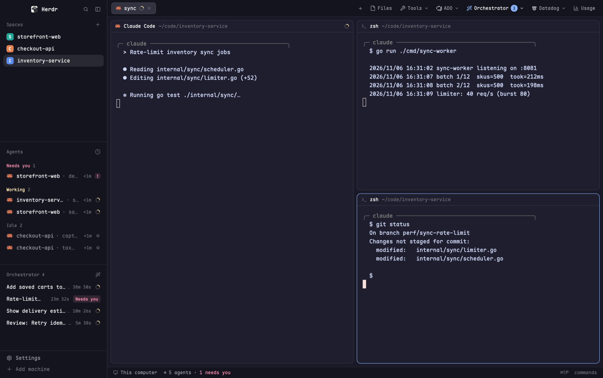

# Pane Cycle

Press `ctrl-tab` to jump to the next terminal pane in the whole window, and
`ctrl-shift-tab` to jump back. Unlike herdr's built-in `pane.go`, which stays
inside the current tab, this walks every pane in every tab of every space and
wraps around at the end. Nothing appears on screen: the focus ring simply moves,
switching tab or space when it needs to.

## What you see

- No panel, no popup, no toast. Each key press opens a 1×1px overlay with no
  frame, which closes itself straight away, so the only visible change is the
  focused pane (and the selected tab and space, when the next pane lives in
  another one).

## How it behaves

- **`ctrl-tab`** (`mod.open:pane-next`): focuses the next pane.
  **`ctrl-shift-tab`** (`mod.open:pane-prev`): focuses the previous one.
  Both are bound in the `global` section of `keys.json`.
- **Order:** spaces in the order `spaces()` lists them, then each space's tabs in
  order, then the panes of each tab in the order `panes()` lists them (layout
  order). Example: space "Storefront" with tabs A (2 panes) and B (1 pane), then
  space "Checkout" with tab C (1 pane) gives A1, A2, B1, C1, and `ctrl-tab` on C1
  goes back to A1.
- **Wraps** in both directions.
- **Only terminal panes** count. Mod panes (panes without a `terminal`) are
  skipped.
- **Fewer than 2 terminal panes:** does nothing.
- **No focused pane** (for example a layout terminal block has focus, so
  `focused().pane` is null): next goes to the first pane, prev to the last.
- No refresh, no polling, nothing persists, no settings in `addons.json`.

## Built from

- **`mods/pane-next/`** and **`mods/pane-prev/`**, identical except for one
  constant at the top of `main.js`: `STEP = 1` or `STEP = -1`.
- **`mod.json`** (title "Pane next" / "Pane prev"):
  `{ "place": "none", "title": "Pane next", "overlay": { "kind": "popup", "width": 1, "height": 1, "frame": "none" } }`
- **`main.js`**: a `View` whose `render` returns an empty `div()`. All the work is
  in `init`:
  1. `closeOverlay(props().overlay)` if an overlay id was passed.
  2. `panes().filter(p => p.terminal)`.
  3. Build the order with
     `spaces().flatMap(s => s.tabs.flatMap(t => all.filter(p => p.tab === t.id)))`.
  4. Find the index of `focused()?.pane`; if not found, start from -1 (next) or
     0 (prev).
  5. `run("pane.focus", { pane: order[(from + STEP + n) % n].pane })`.
- **herdr functions:** `spaces`, `panes`, `focused`, `props`, `run`,
  `closeOverlay`. **Command:** `pane.focus {pane}`.
- **`keys.json`:**
  `{ "global": { "ctrl-tab": "mod.open:pane-next", "ctrl-shift-tab": "mod.open:pane-prev" } }`
- No props beyond the `overlay` id herdr passes, no programs, no network, no
  files read, no icons or art.

## Watch out

- `place` must be `"none"` with an `overlay` block, or the mod would dock as a
  panel. Keep the overlay at 1×1 with `frame: "none"` so nothing flashes.
- Close the overlay at the start of `init`. If it stays open, the next press of
  the same key (`mod.open` on an open mod) closes it instead of moving focus.
- Use `run("pane.focus", {pane})`, not `pane.go`: `pane.go` only moves inside
  the current tab.
- Filter on `p.terminal` before ordering, or focus can land on a mod pane.
- `panes()` lists only model panes. Terminal blocks drawn inside a layout are not
  in the cycle.
- `ctrl-tab` may already be bound in the person's `keys.json`; ask before
  replacing it.

## Done when

- `herdr-app check` passes for both mods.
- With two tabs of two panes each, `ctrl-tab` four times visits all four panes
  and returns to the start; `ctrl-shift-tab` visits them in reverse.
- From the last pane of the last tab in the last space, `ctrl-tab` focuses the
  first pane of the first space, switching space and tab.
- Pressing either key repeatedly keeps moving focus (the overlay never stays
  open), and nothing visible is drawn.
- With a single terminal pane, either key does nothing.
